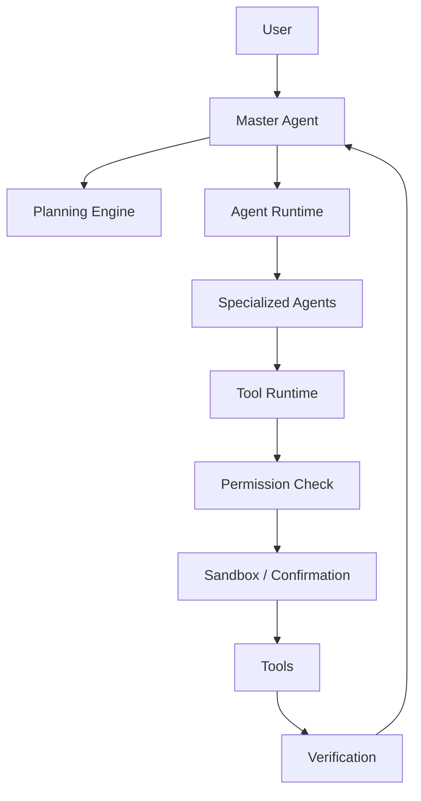
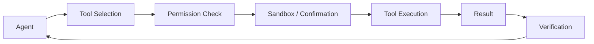
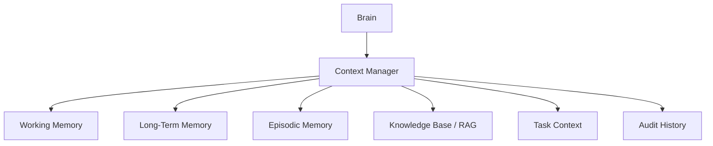
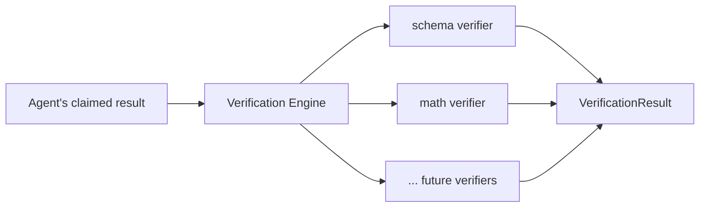
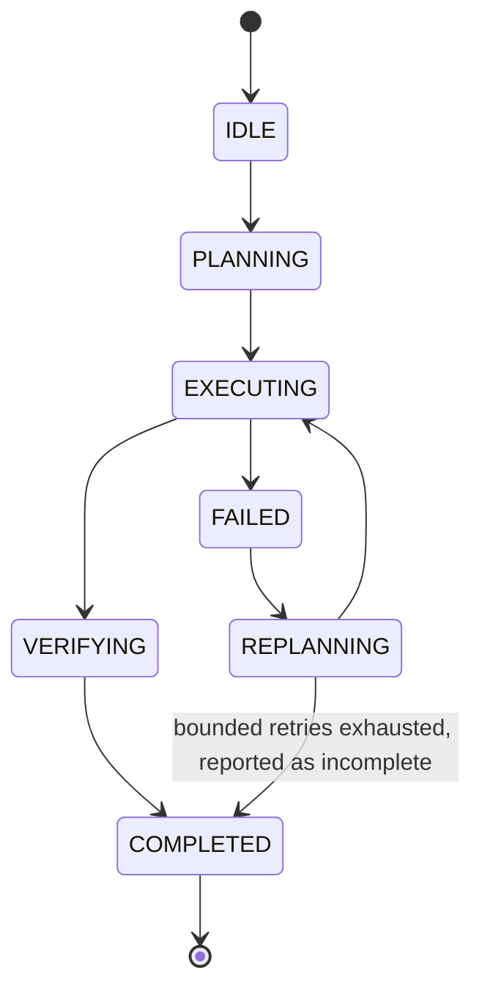
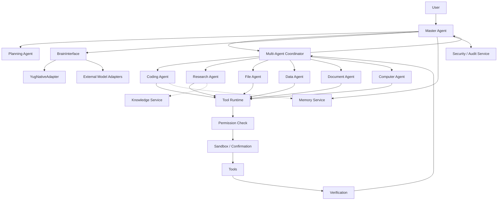

# YUG Agent & Capability Architecture v1

**Status: FUTURE ARCHITECTURE SPECIFICATION ONLY.** Nothing in this
document is implemented merely by being written here. No `NB-13` is
assigned. `ARCHITECTURE/POST_NB07_ROADMAP.md` is not amended, and no
milestone numbering changes. Where this document proposes something
not yet in the repository, it is marked `[PROPOSAL]`, `[DEFERRED]`,
`[NOT IMPLEMENTED]`, or `[UNKNOWN]` — never presented as done.

---

## 1. Executive Summary

YUG's near-term repository (NB-01–NB-12, frozen) has built a real,
tested, model-replaceable brain abstraction (`BrainInterface`), a
native transformer implementation and training/evaluation pipeline,
and a small but genuinely-working tool-execution and verification
substrate — but it has **no agent, no planner, no autonomy, no memory
beyond a flat key-value store, and no multimodal, RAG, or model-routing
capability of any kind** `[VERIFIED IN REPOSITORY]` (§20). This
document specifies where a future agent/capability system would sit
relative to that real foundation, without claiming any of it exists
yet and without touching the foundation itself.

The central architectural decision this document makes explicit
(§26, DECISION-001/002): **28 candidate "agents" and 90 candidate
"capabilities" does not mean 28 agent processes and 90 agent
processes.** Most of the 90 capabilities are services a small number
of agents (or, more often, platform infrastructure) invoke — not
independent autonomous entities. §5–§11 work through which of the 28
candidates should actually be agents versus subsystems, tool adapters,
workflows, or platform services, with reasoning, not by assumption.

## 2. Scope

In scope: a specification of the future agent/capability architecture,
its relationship to the existing, real `BrainInterface`/`YugCore`/
tool/verification substrate, and an honest accounting of what exists
today versus what is proposed. Out of scope: implementing any agent,
capability, permission category, sandbox extension, or roadmap
amendment. This document does not authorize any of the above.

## 3. Evidence Classification

Used throughout, applied strictly — a claim is never upgraded past
what was actually checked:

| Tag | Meaning |
|---|---|
| `[VERIFIED IN REPOSITORY]` | Confirmed by direct inspection of source this session |
| `[VERIFIED BY TEST]` | Confirmed by an existing, real test in the repository |
| `[SOURCE-DERIVED]` | A conclusion drawn directly from verified evidence, not itself independently verified |
| `[PROPOSAL]` | This document's own suggestion, not existing anywhere in the repository |
| `[ASSUMPTION]` | A working assumption this document makes, flagged as such |
| `[DECISION]` | A Chief-level architectural decision this document records (§26) |
| `[DEFERRED — FUTURE ROADMAP DECISION REQUIRED]` | Would need a formal, separate roadmap amendment before implementation |
| `[UNKNOWN]` | Genuinely not resolved by existing evidence or this document |

## 4. Current YUG Architecture

`[VERIFIED IN REPOSITORY]`, re-inspected this session (full detail in
§20's status table; summarized here):

```
BrainInterface (yug/brain/interface.py)
   ├── MockBrainAdapter
   ├── LlamaCppAdapter
   └── YugNativeAdapter  ── YugTransformer, native generation, checkpoint I/O

YugCore (yug/runtime/core.py)
   ├── brain: BrainInterface           (required)
   ├── memory: WorkingMemory           (required — flat key-value store only)
   ├── executor: ToolExecutor | None   (optional, real but unwired by composition.py)
   └── verification_engine: VerificationEngine | None  (optional, real but unwired)

yug/tools/     — ToolExecutor, ToolRegistry, PermissionChecker (flat allow-list),
                 sandbox.run_python_code (POSIX resource-limited subprocess),
                 builtin: calculator, file_read, file_search, python_exec
yug/verification/ — VerificationEngine, two verifiers: schema, math
training/      — Trainer, checkpoint I/O, evaluation harness, NB-08 experiments
```

Confirmed by direct search this session — **zero matches** anywhere in
`yug/` or `training/` for: any `Agent` class, any `Planner` class, any
audit-log mechanism, any RAG/knowledge-base class, any model-routing
mechanism, any vision/voice/OCR class `[VERIFIED IN REPOSITORY]`. Tool
and verification integration through `YugCore.respond(tool_name=...,
verify_name=...)` is real and tested (`tests/test_runtime_tools.py`,
`tests/test_runtime_verification.py`) `[VERIFIED BY TEST]`, but this is
**explicit, caller-specified single-call invocation** — the brain
itself cannot decide to call a tool: both adapters report
`supports_tools=False` and raise `GenerationError` if `tools` is
non-empty `[VERIFIED IN REPOSITORY]`. This is the single most important
existing constraint on everything else in this document: **no
autonomous, brain-driven tool use exists today, at any level.**

Where repository evidence bears on the principles listed in the task
prompt: all of them check out as accurately describing the current
repository — `[VERIFIED IN REPOSITORY]`, not `[SOURCE-DERIVED]` from
the prompt alone. No contradiction found.

## 5. Agent vs Capability vs Tool vs Platform

Four distinct kinds of thing are conflated in casual usage; this
document keeps them separate throughout:

- **Agent**: an entity that makes a judgment call — decomposes a goal,
  chooses between options, decides when it's done. Requires brain
  involvement (even if bounded/deterministic-assisted).
- **Capability**: a named function a user or agent can invoke
  ("summarize this", "run this code"). A capability is *provided by*
  an agent or a platform service; it is not itself an actor.
- **Tool**: a concrete, narrow, callable operation (`file_read`,
  `run_python_code`) — the mechanism a capability is implemented with.
- **Platform service**: deterministic infrastructure every agent
  depends on but that must never itself be an agent, precisely because
  it exists to constrain agents (permissions, sandboxing, audit,
  verification) — an agent that could argue its way past its own
  guardrail is not a guardrail. `[PROPOSAL]`, consistent with the
  existing, real `PermissionChecker`/`VerificationEngine` already
  being plain deterministic classes, not brain-driven.

`[DECISION]` (see §26, DECISION-001/003): capabilities are reusable
services, not independent agents; permission/sandbox/verification/
audit are platform-level, never agent-level.

## 6. Agent Architecture



`[PROPOSAL]`, evaluated rather than assumed (§4 of the task's own
framing): the structure is directionally right but the task's suggested
tree (Master / Planning Engine / Agent Runtime / Tool Runtime / Memory
/ Knowledge-RAG / Verification / Permission-Safety / Sandbox /
Workflow / Integration / Multimodal / Evaluation / Training /
Monitoring) is a reasonable top-level decomposition, with one
correction: **Verification, Permission/Safety, Sandbox, and Monitoring
are platform services the other branches depend on, not siblings of
equal kind to Master Agent** — §11 makes this explicit per-function.

## 7. 28-Agent Catalog

### 7.0 Classification Overview

Per the task's own instruction not to assume every catalog entry is an
independent process — the classification below is this document's
architectural judgment, explained per-agent in §7.1–§7.28:

| # | Agent | Classification |
|---|---|---|
| 1 | Master Agent | Independent agent |
| 2 | Planning Agent | Independent agent (deterministic-algorithm-assisted, not brain-only) |
| 3 | Coding Agent | Independent agent |
| 4 | Research Agent | Independent agent |
| 5 | Web Agent | Capability provider (folds into Research Agent's toolset) |
| 6 | Memory Agent | **Platform service** (not an agent — memory must not be a persuadable actor) |
| 7 | File Agent | Independent agent |
| 8 | Tool Agent | **Platform service** (the tool runtime itself, not a decision-maker) |
| 9 | Verification Agent | **Platform service** (already exists as `VerificationEngine`; must not be gameable) |
| 10 | Terminal Agent | Tool adapter (subsumed under Coding/File Agent toolsets) |
| 11 | Git Agent | Tool adapter (subsumed under Coding Agent's toolset) |
| 12 | Data Agent | Independent agent |
| 13 | Security Agent | **Platform service** (deterministic enforcement, not an arguable agent) |
| 14 | Computer Agent | Independent agent — high risk, latest phase |
| 15 | Document Agent | Independent agent |
| 16 | Project Manager Agent | Independent agent (goal/timeline ownership, distinct from #28) |
| 17 | Communication Agent | Capability provider (permission-gated tool wrapper) |
| 18 | Scheduler Agent | **Platform service** (deterministic triggering, not judgment) |
| 19 | Vision Agent | Future integration (multimodal does not exist) |
| 20 | Voice Agent | Future integration (multimodal does not exist) |
| 21 | Automation Agent | Workflow (tied to the Workflow Engine, not a standalone agent) |
| 22 | Browser Agent | Tool adapter, high risk, latest phase |
| 23 | API Agent | Tool adapter |
| 24 | Knowledge Agent | **Platform service** (RAG/knowledge retrieval, infrastructure like Memory) |
| 25 | Evaluation Agent | **Platform service** (deterministic measurement, extends NB-09's pattern) |
| 26 | Training Agent | **Platform service**, training-boundary-constrained (§27) |
| 27 | System Agent | **Platform service** (diagnostics/monitoring) |
| 28 | Multi-Agent Coordinator | Independent agent/subsystem — execution-time dispatch, distinct from #1 and #2 |

Net result: of 28 catalog entries, **10 are proposed as genuine
independent agents**, 11 as platform services, 4 as tool adapters, 2
as capability providers, 1 as a workflow concept. This is the
concrete rebuttal to "90 capabilities = 90 agents" (§19, Anti-pattern
1) applied one level up, to the agent catalog itself.

### 7.1 — Master Agent
**Classification**: Independent agent
- **Purpose**: Own the user's goal end-to-end; the single accountable entity for a request.
- **Responsibilities**: Understand the goal; decide whether Planning is needed; delegate to specialized agents or the Coordinator (#28); collect results; request Verification before reporting success; communicate the final result honestly (including partial failure).
- **Non-responsibilities**: Does not execute tools directly; does not bypass Verification's judgment; does not itself decide autonomy level for a task category (§17 is a platform policy, not the Master Agent's to set).
- **Primary capabilities**: 2 Reasoning, 10 Planning, 83 Agent orchestration (see §9).
- **Secondary capabilities**: 1 Conversation, 78 Decision support.
- **Required inputs**: user request, conversation history, current autonomy-level policy.
- **Expected outputs**: a `Response` (existing type, `yug/runtime/types.py`) or, in future form, a richer result object carrying task provenance.
- **Required tools**: none directly — delegates.
- **Memory access**: read/write working memory (existing); read (not write) long-term/episodic memory `[PROPOSAL]`.
- **Knowledge access**: read-only, via Knowledge platform service (#24).
- **Permission level**: elevated (can invoke other agents) but never bypasses per-tool permission checks those agents make.
- **Verification requirements**: must request Verification (#9) before reporting a task complete for any non-trivial multi-step goal.
- **Confirmation requirements**: per Autonomy Level (§17) of the task's most sensitive sub-action.
- **Sandbox requirements**: none directly.
- **Failure handling**: surface failure honestly (matches `YugCore.respond()`'s existing "never raises, structured failure" convention `[VERIFIED IN REPOSITORY]`, extended here).
- **Retry/replanning**: may trigger Planning Agent replanning (§13) up to a bounded retry count.
- **Dependencies**: BrainInterface, Planning Agent, Multi-Agent Coordinator, Verification service.
- **Can operate autonomously?**: Only within the currently-approved Autonomy Level.
- **Human approval required?**: For any action at or above the level requiring it (§17/§12).
- **Current repository status**: `[NOT IMPLEMENTED]`. `YugCore.respond()` is the closest existing analog — single-turn, no delegation, no planning `[VERIFIED IN REPOSITORY]`.
- **Implementation phase**: Phase A.
- **Evidence classification**: `[PROPOSAL]`.

### 7.2 — Planning Agent
**Classification**: Independent agent, deterministic-algorithm-assisted
- **Purpose**: Turn a goal into an ordered, dependency-aware execution plan.
- **Responsibilities**: `goal → decomposition → ordered tasks → dependencies → execution plan → verification points` (exact pipeline required by the task prompt).
- **Non-responsibilities**: Does not execute tasks; does not itself talk to the user (Master Agent does).
- **Primary capabilities**: 10 Planning, 11 Autonomous tasks (bounded).
- **Secondary capabilities**: 2 Reasoning, 46 Project management.
- **Required inputs**: goal statement from Master Agent, known agent/tool capabilities registry.
- **Expected outputs**: an ordered task graph with declared verification points.
- **Required tools**: none directly.
- **Memory access**: read working memory for task context; write plan state.
- **Knowledge access**: read-only.
- **Permission level**: none beyond read access — planning proposes, never executes.
- **Verification requirements**: each planned task must declare its own verification point (task prompt's explicit requirement).
- **Confirmation requirements**: the plan itself may require human confirmation before execution begins, per Autonomy Level.
- **Sandbox requirements**: none.
- **Failure handling**: if decomposition is not possible (goal too ambiguous), reports this rather than guessing.
- **Retry/replanning**: is itself the target of Master Agent's replanning trigger (§13) — receives failure context and produces a revised plan, bounded retry count `[PROPOSAL]`.
- **Dependencies**: Master Agent, Knowledge/RAG service, Agent registry.
- **Can operate autonomously?**: Yes, within its own scope (producing a plan is lower-risk than executing one) — but the *plan's* execution remains gated by Autonomy Level.
- **Human approval required?**: Not for producing a plan; may be for approving one before execution.
- **Current repository status**: `[NOT IMPLEMENTED]`. No decomposition, dependency-graph, or planning code exists anywhere `[VERIFIED IN REPOSITORY]`.
- **Implementation phase**: Phase A.
- **Evidence classification**: `[PROPOSAL]`.

### 7.3 — Coding Agent
**Classification**: Independent agent
- **Purpose**: Write, modify, and reason about code on the user's behalf.
- **Responsibilities**: 20 Coding, 21 Debugging, 22 Testing, 23 Build systems, 26 Codebase understanding.
- **Non-responsibilities**: Does not deploy to production systems without explicit high-level approval; does not bypass existing test suites.
- **Primary capabilities**: 20, 21, 22, 23, 26.
- **Secondary capabilities**: 25 Git (via tool adapter #11), 24 Terminal (via #10).
- **Required inputs**: task description, relevant file/codebase context.
- **Expected outputs**: code diffs, test results, explanations.
- **Required tools**: file_read/file_search (existing `[VERIFIED IN REPOSITORY]`), a future file-write tool `[NOT IMPLEMENTED]`, terminal/git tool adapters `[NOT IMPLEMENTED]`.
- **Memory access**: read/write task-scoped working memory.
- **Knowledge access**: read-only codebase knowledge (via #24).
- **Permission level**: `LOCAL_WRITE`, `EXECUTE` (§12) — among the higher-risk agents.
- **Verification requirements**: must run tests (existing infra pattern, this whole session's own methodology) before claiming success; Verification service confirms, not the agent's own say-so.
- **Confirmation requirements**: file writes and command execution above L2 require confirmation (§17).
- **Sandbox requirements**: code execution must go through the existing `run_python_code` sandbox pattern `[VERIFIED IN REPOSITORY]`, extended to other languages `[PROPOSAL]`.
- **Failure handling**: reports failing tests/errors verbatim, does not silently retry with weakened checks (this whole session's own established discipline, generalized).
- **Retry/replanning**: bounded automatic retry on a clearly-transient failure (e.g. flaky test); anything else escalates to Planning Agent.
- **Dependencies**: file tools, terminal/git tool adapters, Verification service, Sandbox.
- **Can operate autonomously?**: Up to L2/L3 depending on blast radius (§17).
- **Human approval required?**: For any change outside a sandboxed/reversible scope.
- **Current repository status**: `[NOT IMPLEMENTED]`. `python_exec`'s sandbox is real and reusable `[VERIFIED IN REPOSITORY]`; no file-write, git, or multi-step coding-task logic exists.
- **Implementation phase**: Phase B.
- **Evidence classification**: `[PROPOSAL]`.

### 7.4 — Research Agent
**Classification**: Independent agent
- **Purpose**: Answer questions requiring synthesis across multiple sources.
- **Responsibilities**: 45 Research workflows, 14 Web research, 15 Source verification, 16 Current information.
- **Non-responsibilities**: Does not take action based on research without Master Agent/user sign-off.
- **Primary capabilities**: 14, 15, 16, 45.
- **Secondary capabilities**: 8 Summarization, 9 Question answering.
- **Required inputs**: research question, scope/depth guidance.
- **Expected outputs**: synthesized findings with source attribution.
- **Required tools**: Web Agent (#5, capability provider) for search/fetch.
- **Memory access**: write findings to task-scoped memory.
- **Knowledge access**: read/write to Knowledge service (caches findings for reuse) `[PROPOSAL]`.
- **Permission level**: `NETWORK` (§12).
- **Verification requirements**: 15 Source verification is itself one of this agent's own outputs, not outsourced.
- **Confirmation requirements**: none for read-only research; confirmation only if research triggers a paid/rate-limited external service.
- **Sandbox requirements**: none beyond normal network-tool permissioning.
- **Failure handling**: reports what could and couldn't be found, not a fabricated answer (existing project-wide evidence discipline, generalized to a future agent).
- **Retry/replanning**: retries individual failed fetches; escalates if the whole research goal is unanswerable.
- **Dependencies**: Web Agent, Knowledge service.
- **Can operate autonomously?**: Yes, for read-only research (L1–L2).
- **Human approval required?**: No, for pure information-gathering.
- **Current repository status**: `[NOT IMPLEMENTED]`.
- **Implementation phase**: Phase B.
- **Evidence classification**: `[PROPOSAL]`.

### 7.5 — Web Agent
**Classification**: Capability provider (not an independent agent — folds into Research Agent's toolset, avoiding a redundant standalone entity for what is fundamentally "web search/fetch as a tool")
- **Purpose**: Provide web search/fetch as a governed capability.
- **Responsibilities**: 13 Web search, execute fetch/search tool calls.
- **Non-responsibilities**: Does not synthesize or judge source quality (Research Agent's job).
- **Primary capabilities**: 13 Web search.
- **Secondary capabilities**: none.
- **Required inputs**: query/URL.
- **Expected outputs**: raw search results/page content.
- **Required tools**: a future web-search/fetch tool `[NOT IMPLEMENTED]`.
- **Memory access**: none.
- **Knowledge access**: none.
- **Permission level**: `NETWORK`.
- **Verification requirements**: none itself (upstream Research Agent verifies sources).
- **Confirmation requirements**: none for ordinary search.
- **Sandbox requirements**: outbound-network-only, no filesystem/execution access.
- **Failure handling**: report fetch failures plainly.
- **Retry/replanning**: bounded automatic retry on transient network failure.
- **Dependencies**: none beyond a network tool.
- **Can operate autonomously?**: Yes (L1).
- **Human approval required?**: No.
- **Current repository status**: `[NOT IMPLEMENTED]`.
- **Implementation phase**: Phase B.
- **Evidence classification**: `[PROPOSAL]`.

### 7.6 — Memory Agent
**Classification**: **Platform service, not an agent.** Memory must be governed by deterministic policy, not by an entity that could be persuaded to leak, overwrite, or misclassify what it stores (§19, Anti-pattern 5).
- **Purpose**: Own read/write policy for working, long-term, and episodic memory (§14).
- **Responsibilities**: enforce memory-access policy per calling agent's permission level; never mutated by arbitrary agents without going through this policy layer.
- **Non-responsibilities**: does not decide *what* is worth remembering in a judgment sense (an agent proposes; this service enforces storage policy).
- **Primary capabilities**: 29 Long-term memory, 30 Memory retrieval, 31 Memory management.
- **Secondary capabilities**: none.
- **Required inputs**: read/write requests with calling-agent identity.
- **Expected outputs**: memory read results; write acknowledgments.
- **Required tools**: none (it is infrastructure, not a tool consumer).
- **Memory access**: is the memory layer.
- **Knowledge access**: distinct from Knowledge service (§14) — memory is about *this user's history*, knowledge is about *general reference material*.
- **Permission level**: enforces, does not hold, permission.
- **Verification requirements**: none itself.
- **Confirmation requirements**: none for reads; writes of sensitive categories may require policy-level confirmation `[PROPOSAL]`.
- **Sandbox requirements**: n/a.
- **Failure handling**: reject writes that violate policy rather than silently dropping them.
- **Retry/replanning**: n/a.
- **Dependencies**: none.
- **Can operate autonomously?**: n/a — it is infrastructure, not a decision-maker.
- **Human approval required?**: n/a.
- **Current repository status**: `WorkingMemory` (flat key-value, JSON-persisted) exists and is real `[VERIFIED IN REPOSITORY]`; no long-term/episodic layer exists `[VERIFIED IN REPOSITORY]`.
- **Implementation phase**: Phase B (extends existing `WorkingMemory`).
- **Evidence classification**: `[PROPOSAL]` for everything beyond the existing `WorkingMemory`.

### 7.7 — File Agent
**Classification**: Independent agent
- **Purpose**: Manage file-system interaction on the user's behalf.
- **Responsibilities**: 17 File management, invoking file tools under permission control.
- **Non-responsibilities**: Does not write outside an explicitly permitted root (mirrors existing `file_root` scoping in `build_default_tools` `[VERIFIED IN REPOSITORY]`).
- **Primary capabilities**: 17 File management.
- **Secondary capabilities**: 18 Document analysis, 72 File conversion.
- **Required inputs**: file operation request, scope/root.
- **Expected outputs**: file contents, search results, write confirmations.
- **Required tools**: `file_read`, `file_search` (existing `[VERIFIED IN REPOSITORY]`); a future `file_write` tool `[NOT IMPLEMENTED]`.
- **Memory access**: task-scoped only.
- **Knowledge access**: none.
- **Permission level**: `READ_ONLY` for read tools (existing); `LOCAL_WRITE` for a future write tool.
- **Verification requirements**: write operations verified (content matches intent) before reporting success.
- **Confirmation requirements**: writes/deletes require confirmation at L2+.
- **Sandbox requirements**: root-scoped, exactly as existing read tools already are `[VERIFIED IN REPOSITORY]`.
- **Failure handling**: report permission/path errors plainly (existing tools already do this via `ToolExecutionError`-style patterns `[VERIFIED IN REPOSITORY]`).
- **Retry/replanning**: none typically needed (file ops are usually deterministic pass/fail).
- **Dependencies**: file tools, PermissionChecker.
- **Can operate autonomously?**: Read: yes (L1). Write/delete: L2+.
- **Human approval required?**: For destructive operations.
- **Current repository status**: read-side tools exist and are tested `[VERIFIED BY TEST]` (`tests/test_runtime_tools.py`); no write tool, no agent wrapper.
- **Implementation phase**: Phase B.
- **Evidence classification**: `[PROPOSAL]` for the agent layer; `[VERIFIED IN REPOSITORY]` for the read-tool foundation it would sit on.

### 7.8 — Tool Agent
**Classification**: **Platform service** — the tool runtime itself (§16), not a judgment-making agent. Agents *use* tools through this service; it does not itself decide *whether* a goal needs a tool (that's the calling agent's/Master Agent's job).
- **Purpose**: Select and invoke the correct tool for a named request, enforcing permission/sandbox/verification ordering.
- **Responsibilities**: implement the `Agent → Tool Selection → Permission Check → Sandbox/Confirmation → Tool Execution → Result → Verification → Agent` pipeline (§16).
- **Non-responsibilities**: does not decide task-level strategy.
- **Primary capabilities**: 12 Tool use (as infrastructure, not as a brain decision).
- **Secondary capabilities**: none.
- **Required inputs**: tool name, parameters, calling-agent identity.
- **Expected outputs**: `ToolResult` (existing type `[VERIFIED IN REPOSITORY]`).
- **Required tools**: is the layer that holds them (`ToolRegistry`, existing `[VERIFIED IN REPOSITORY]`).
- **Memory access**: none.
- **Knowledge access**: none.
- **Permission level**: enforces, does not hold, permission — delegates to `PermissionChecker` (existing `[VERIFIED IN REPOSITORY]`).
- **Verification requirements**: forwards results for Verification; does not self-certify.
- **Confirmation requirements**: enforces confirmation gates per Autonomy Level.
- **Sandbox requirements**: routes execution through Sandbox for any tool that needs it.
- **Failure handling**: existing `ToolExecutor` pattern already returns structured failure, not exceptions, for permission denial `[VERIFIED BY TEST]`.
- **Retry/replanning**: n/a — infrastructure, not a planner.
- **Dependencies**: PermissionChecker, Sandbox, ToolRegistry (all exist `[VERIFIED IN REPOSITORY]`).
- **Can operate autonomously?**: n/a.
- **Human approval required?**: n/a.
- **Current repository status**: **substantially exists already** — `ToolExecutor`, `ToolRegistry`, `PermissionChecker` are real, tested `[VERIFIED IN REPOSITORY]`, `[VERIFIED BY TEST]`; only brain-autonomous invocation (vs. today's explicit `tool_name=...` call) is missing.
- **Implementation phase**: Phase A (extends existing infra).
- **Evidence classification**: `[SOURCE-DERIVED]` — mostly already real, not a new proposal.

### 7.9 — Verification Agent
**Classification**: **Platform service.** The task prompt's own instruction — "it must not simply accept an agent's claim that something succeeded" — is precisely why this must be deterministic infrastructure, not itself an agent whose judgment could be socially engineered by the agent it's checking.
- **Purpose**: Independently confirm a claimed result, never trusting self-report.
- **Responsibilities**: run named verifiers (schema, math — existing `[VERIFIED IN REPOSITORY]`; more in future) against a claimed outcome.
- **Non-responsibilities**: does not perform the task itself, does not accept "I'm confident it worked" as evidence.
- **Primary capabilities**: 51 Verification.
- **Secondary capabilities**: 53 Self-evaluation (of the *system*, not of an agent's own unverified claim).
- **Required inputs**: verifier name, claim, evidence.
- **Expected outputs**: `VerificationResult` (existing type `[VERIFIED IN REPOSITORY]`).
- **Required tools**: none — verifiers are pure functions.
- **Memory access**: none.
- **Knowledge access**: none.
- **Permission level**: read-only relative to the claim being checked.
- **Verification requirements**: is the verification layer.
- **Confirmation requirements**: none.
- **Sandbox requirements**: none beyond what a specific verifier needs (e.g. running code to check a coding claim would route through Sandbox).
- **Failure handling**: an unknown verifier name propagates as an error, not a false pass (`VerifierNotFoundError`, existing `[VERIFIED IN REPOSITORY]`).
- **Retry/replanning**: a failed verification triggers Master Agent's replanning, not a silent re-check with looser criteria.
- **Dependencies**: none beyond the specific verifier's own needs.
- **Can operate autonomously?**: n/a.
- **Human approval required?**: n/a.
- **Current repository status**: **substantially exists** — `VerificationEngine` with `schema`/`math` verifiers is real and tested `[VERIFIED IN REPOSITORY]`, `[VERIFIED BY TEST]`; only broader verifier coverage (code-test-passing, generation-quality, etc.) is future work.
- **Implementation phase**: Phase A (extends existing infra).
- **Evidence classification**: `[SOURCE-DERIVED]`.

### 7.10 — Terminal Agent
**Classification**: Tool adapter — a thin, permission-gated wrapper around shell execution, subsumed under Coding/File Agent's toolset rather than a standalone decision-maker.
- **Purpose**: Execute shell commands under sandbox/permission control.
- **Responsibilities**: 24 Terminal.
- **Non-responsibilities**: does not decide task strategy.
- **Primary capabilities**: 24 Terminal.
- **Secondary capabilities**: none.
- **Required inputs**: command, working directory, timeout.
- **Expected outputs**: stdout/stderr/exit code (mirrors existing `SandboxResult` shape for `run_python_code` `[VERIFIED IN REPOSITORY]`).
- **Required tools**: a future generalized shell-execution tool, built on the existing sandbox primitives `[NOT IMPLEMENTED]`.
- **Memory access**: none.
- **Knowledge access**: none.
- **Permission level**: `EXECUTE`.
- **Verification requirements**: exit code/output checked by Verification, not self-reported.
- **Confirmation requirements**: any command outside a pre-approved allow-list requires confirmation.
- **Sandbox requirements**: mandatory — reuses `yug/tools/sandbox.py`'s existing resource-limited subprocess pattern `[VERIFIED IN REPOSITORY]`.
- **Failure handling**: non-zero exit and timeouts both reported as structured results, never silently swallowed (existing `run_python_code` convention `[VERIFIED IN REPOSITORY]`).
- **Retry/replanning**: none automatic — a failed command surfaces, doesn't silently rerun with different flags.
- **Dependencies**: Sandbox.
- **Can operate autonomously?**: Allow-listed commands only, at L1–L2.
- **Human approval required?**: For anything outside the allow-list.
- **Current repository status**: sandbox primitive exists for Python specifically `[VERIFIED IN REPOSITORY]`; general shell execution does not.
- **Implementation phase**: Phase B.
- **Evidence classification**: `[PROPOSAL]`.

### 7.11 — Git Agent
**Classification**: Tool adapter, subsumed under Coding Agent's toolset.
- **Purpose**: Perform version-control operations under permission control.
- **Responsibilities**: 25 Git.
- **Non-responsibilities**: does not push to remote/force-push without explicit high-level approval.
- **Primary capabilities**: 25 Git.
- **Secondary capabilities**: none.
- **Required inputs**: repo path, operation, parameters.
- **Expected outputs**: operation result (diff, commit hash, status).
- **Required tools**: a future git-tool adapter `[NOT IMPLEMENTED]` — this session's own repeated "git unavailable in sandbox" experience (NB-10/11/12 closures) is direct evidence such a tool doesn't exist yet even as infrastructure.
- **Memory access**: none.
- **Knowledge access**: none.
- **Permission level**: `LOCAL_WRITE` (local commits) vs `NETWORK`+`HIGH_IMPACT` (push/force-push) — clearly separated.
- **Verification requirements**: diff/status checked before any commit is reported as done.
- **Confirmation requirements**: commits at L2+, pushes always require confirmation regardless of level `[PROPOSAL]`.
- **Sandbox requirements**: repo-root-scoped.
- **Failure handling**: merge conflicts/failures reported plainly, not auto-resolved silently.
- **Retry/replanning**: none automatic for conflicts — escalates.
- **Dependencies**: Terminal tool adapter (or a native git library binding).
- **Can operate autonomously?**: Local, reversible operations at L2; remote operations require approval regardless of level.
- **Human approval required?**: Always for push/force-push.
- **Current repository status**: `[NOT IMPLEMENTED]`.
- **Implementation phase**: Phase B.
- **Evidence classification**: `[PROPOSAL]`.

### 7.12 — Data Agent
**Classification**: Independent agent
- **Purpose**: Analyze structured/tabular data on the user's behalf.
- **Responsibilities**: 19 Data analysis, 27 Database.
- **Non-responsibilities**: does not mutate production data stores without explicit approval.
- **Primary capabilities**: 19, 27.
- **Secondary capabilities**: 7 Mathematics, 71 Report generation.
- **Required inputs**: data source, analysis goal.
- **Expected outputs**: findings, tables, generated reports.
- **Required tools**: a future data-access tool `[NOT IMPLEMENTED]`; `calculator` (existing `[VERIFIED IN REPOSITORY]`) for simple arithmetic.
- **Memory access**: task-scoped.
- **Knowledge access**: read-only.
- **Permission level**: `READ_ONLY` typically; `LOCAL_WRITE`/`EXTERNAL_SERVICE` for database mutation.
- **Verification requirements**: numerical claims verified via the existing `math` verifier where applicable `[VERIFIED IN REPOSITORY]`.
- **Confirmation requirements**: any write/mutating query requires confirmation.
- **Sandbox requirements**: query execution sandboxed similarly to code execution.
- **Failure handling**: malformed queries/data reported, not silently coerced.
- **Retry/replanning**: bounded retry on transient connection failure.
- **Dependencies**: a data-access tool, Verification.
- **Can operate autonomously?**: Read-only analysis at L1–L2.
- **Human approval required?**: For any write.
- **Current repository status**: `[NOT IMPLEMENTED]`.
- **Implementation phase**: Phase C.
- **Evidence classification**: `[PROPOSAL]`.

### 7.13 — Security Agent
**Classification**: **Platform service.** Security enforcement must be deterministic (§19, Anti-pattern 3: "Agents bypassing permissions") — an "agent" framing invites exactly the failure mode this component exists to prevent.
- **Purpose**: Enforce and audit the permission model (§12) across all other agents/tools.
- **Responsibilities**: 47 Permissions, 50 Audit logs, 88 Safety controls.
- **Non-responsibilities**: does not itself decide task strategy; does not grant itself elevated permission.
- **Primary capabilities**: 47, 50, 88.
- **Secondary capabilities**: 89 Human approval (routing, not deciding).
- **Required inputs**: every tool/action request from every agent.
- **Expected outputs**: allow/deny decisions, audit records.
- **Required tools**: none — it gates them.
- **Memory access**: audit-log storage only (distinct from working/long-term memory, §14).
- **Knowledge access**: none.
- **Permission level**: is the permission layer; cannot be escalated by a request it is evaluating.
- **Verification requirements**: none itself.
- **Confirmation requirements**: routes to human approval, does not itself approve high-impact actions.
- **Sandbox requirements**: n/a.
- **Failure handling**: default-deny on any ambiguous request (`[PROPOSAL]`, consistent with existing `PermissionChecker`'s explicit allow-list-only design `[VERIFIED IN REPOSITORY]`).
- **Retry/replanning**: n/a.
- **Dependencies**: none — everything depends on it.
- **Can operate autonomously?**: n/a — it is the constraint, not an actor.
- **Human approval required?**: n/a.
- **Current repository status**: today's `PermissionChecker` is a flat tool-name allow-list only, **no** autonomy levels, categories, or audit log exist `[VERIFIED IN REPOSITORY]` — the docstring of `yug/tools/permissions.py` says so explicitly.
- **Implementation phase**: Phase A.
- **Evidence classification**: `[PROPOSAL]` for everything beyond the existing flat allow-list.

### 7.14 — Computer Agent
**Classification**: Independent agent — highest-risk catalog entry, latest phase.
- **Purpose**: Operate a full desktop/OS environment on the user's behalf.
- **Responsibilities**: 37 Computer control.
- **Non-responsibilities**: does not operate outside an explicitly sandboxed/virtualized environment `[PROPOSAL]`.
- **Primary capabilities**: 37.
- **Secondary capabilities**: 38 Browser automation (#22 may specialize this).
- **Required inputs**: goal, screen state.
- **Expected outputs**: action sequence, resulting screen state.
- **Required tools**: OS-level automation tool `[NOT IMPLEMENTED]`.
- **Memory access**: task-scoped.
- **Knowledge access**: read-only.
- **Permission level**: `SYSTEM_CONTROL`, `HIGH_IMPACT` — the highest category this document defines (§12).
- **Verification requirements**: every action's on-screen effect verified before the next action (mandatory, not optional, given blast radius).
- **Confirmation requirements**: mandatory per-session confirmation at minimum; per-action confirmation by default `[PROPOSAL]`.
- **Sandbox requirements**: mandatory, isolated environment — never the user's primary session without explicit, separately-justified authorization.
- **Failure handling**: stop and report on any unexpected screen state, never "best-guess" continue.
- **Retry/replanning**: minimal automatic retry — most failures here should escalate to a human, not retry blindly.
- **Dependencies**: Sandbox, Security service, Verification.
- **Can operate autonomously?**: Only at the highest approved Autonomy Level (L4+), and only in Phase E.
- **Human approval required?**: Effectively always, at least at session start.
- **Current repository status**: `[NOT IMPLEMENTED]`.
- **Implementation phase**: Phase E.
- **Evidence classification**: `[PROPOSAL]`.

### 7.15 — Document Agent
**Classification**: Independent agent
- **Purpose**: Analyze and generate documents. **Responsibilities**: 18 Document analysis, 71 Report generation, 72 File conversion. **Non-responsibilities**: does not publish/send documents externally (Communication Agent's job). **Primary capabilities**: 18, 71, 72. **Secondary**: 3 Writing, 4 Rewriting. **Required inputs**: source document/goal. **Expected outputs**: analyzed content or a generated document. **Required tools**: File Agent's read/write tools. **Memory access**: task-scoped. **Knowledge access**: read-only. **Permission level**: `READ_ONLY`/`LOCAL_WRITE`. **Verification**: content checked against source before claiming a faithful conversion. **Confirmation**: writes at L2+. **Sandbox**: none beyond File Agent's. **Failure handling**: malformed source reported, not guessed around. **Retry**: none typical. **Dependencies**: File Agent. **Autonomous?**: Yes for read/analyze (L1); write at L2. **Human approval?**: For writes. **Current status**: `[NOT IMPLEMENTED]`. **Phase**: C. **Evidence**: `[PROPOSAL]`.

### 7.16 — Project Manager Agent
**Classification**: Independent agent — distinct from Multi-Agent Coordinator (#28): this agent owns *goals, status, and timelines* across a body of work; the Coordinator does low-level *execution-time dispatch* of already-planned tasks. A PM Agent without a Coordinator is toothless; a Coordinator without a PM Agent has no sense of the larger goal.
- **Purpose**: Track multi-session/multi-task project state. **Responsibilities**: 46 Project management, status tracking, deadline awareness. **Non-responsibilities**: does not itself execute tasks. **Primary capabilities**: 46. **Secondary**: 10 Planning (delegates detailed decomposition to #2), 79 Personal assistant. **Required inputs**: project goals, task updates. **Expected outputs**: status summaries, next-action recommendations. **Required tools**: none directly. **Memory access**: read/write long-term project memory. **Knowledge access**: read-only. **Permission level**: none beyond memory access. **Verification**: status claims cross-checked against actual task outcomes, not just agent self-report. **Confirmation**: none typically. **Sandbox**: n/a. **Failure handling**: reports stale/unknown status honestly rather than inventing progress. **Retry**: n/a. **Dependencies**: Memory service, Planning Agent. **Autonomous?**: Yes (L1). **Human approval?**: No. **Current status**: `[NOT IMPLEMENTED]`. **Phase**: C. **Evidence**: `[PROPOSAL]`.

### 7.17 — Communication Agent
**Classification**: Capability provider — permission-gated wrapper around external communication tools, not a broad decision-maker.
- **Purpose**: Send/read messages (email, etc.) under explicit permission. **Responsibilities**: 39 Email, and messaging generally. **Non-responsibilities**: does not compose and send without the content being shown/approved first, for anything beyond L1. **Primary capabilities**: 39. **Secondary**: 3 Writing. **Required inputs**: recipient, content, action (read/send). **Expected outputs**: sent confirmation or fetched messages. **Required tools**: a future email/messaging tool `[NOT IMPLEMENTED]`. **Memory access**: task-scoped. **Knowledge access**: none. **Permission level**: `COMMUNICATION` (§12), `EXTERNAL_SERVICE`. **Verification**: recipient/content double-checked before send. **Confirmation**: mandatory before any outbound send, always `[PROPOSAL]` — irreversible by nature. **Sandbox**: n/a (external service call, not local execution). **Failure handling**: delivery failures reported plainly. **Retry**: bounded, transient failures only. **Dependencies**: Security service (permission), external service credentials. **Autonomous?**: Reading: L1. Sending: never fully autonomous — always confirmed. **Human approval?**: Always for sending. **Current status**: `[NOT IMPLEMENTED]`. **Phase**: C. **Evidence**: `[PROPOSAL]`.

### 7.18 — Scheduler Agent
**Classification**: **Platform service** — triggering on a schedule is deterministic infrastructure, not a judgment call.
- **Purpose**: Trigger agent/task execution on a schedule or condition. **Responsibilities**: 41 Scheduling, 75 Continuous workflows (triggering side). **Non-responsibilities**: does not decide *what* to do when triggered (delegates to Master Agent/Planning). **Primary capabilities**: 41. **Secondary**: 76 Monitoring (trigger conditions). **Required inputs**: schedule/condition definition. **Expected outputs**: trigger events. **Required tools**: none. **Memory access**: schedule state only. **Knowledge access**: none. **Permission level**: none beyond what the triggered task itself requires. **Verification**: n/a. **Confirmation**: creating a new recurring schedule may require confirmation `[PROPOSAL]`. **Sandbox**: n/a. **Failure handling**: missed triggers logged, not silently dropped. **Retry**: n/a. **Dependencies**: none. **Autonomous?**: n/a — infrastructure. **Human approval?**: For creating high-impact recurring schedules. **Current status**: `[NOT IMPLEMENTED]`. **Phase**: C. **Evidence**: `[PROPOSAL]`.

### 7.19 — Vision Agent
**Classification**: Future integration — multimodal input processing does not exist in any form `[VERIFIED IN REPOSITORY]`.
- **Purpose**: Process image input. **Responsibilities**: 35 Vision, 36 OCR. **Non-responsibilities**: does not generate images (Image generation, capability 63, is separate). **Primary capabilities**: 35, 36. **Secondary**: 8 Summarization (of visual content). **Required inputs**: image data. **Expected outputs**: textual description/extracted text. **Required tools/models**: a vision-capable model — **not the native YUG brain**, which is text-only `[VERIFIED IN REPOSITORY]`; would require an External Model Adapter (§15). **Memory access**: task-scoped. **Knowledge access**: none. **Permission level**: `READ_ONLY`. **Verification**: n/a beyond normal generation checks. **Confirmation**: none. **Sandbox**: n/a. **Failure handling**: unsupported formats reported. **Retry**: n/a. **Dependencies**: External Model Adapter. **Autonomous?**: Yes (L1). **Human approval?**: No. **Current status**: `[NOT IMPLEMENTED]`. **Phase**: D. **Evidence**: `[PROPOSAL]`.

### 7.20 — Voice Agent
**Classification**: Future integration — same basis as Vision Agent.
- **Purpose**: Voice input/output. **Responsibilities**: 33 Voice input, 34 Voice output. **Non-responsibilities**: does not itself hold a conversation (Master Agent does; this is I/O only). **Primary capabilities**: 33, 34. **Secondary**: none. **Required inputs/outputs**: audio stream / text. **Required tools/models**: speech-to-text/text-to-speech models, external to the native brain. **Memory access**: none. **Knowledge access**: none. **Permission level**: `READ_ONLY` for input; local device access for output. **Verification**: n/a. **Confirmation**: none. **Sandbox**: n/a. **Failure handling**: transcription failure reported. **Retry**: n/a. **Dependencies**: External Model Adapter. **Autonomous?**: Yes (L1). **Human approval?**: No. **Current status**: `[NOT IMPLEMENTED]`. **Phase**: D. **Evidence**: `[PROPOSAL]`.

### 7.21 — Automation Agent
**Classification**: Workflow — tied directly to the Workflow Engine (§24) platform concept rather than a standalone decision-making entity; "automation" is the *execution* of a predefined workflow, not new judgment.
- **Purpose**: Execute predefined multi-step workflows. **Responsibilities**: 43 Workflow automation. **Non-responsibilities**: does not design new workflows from scratch (Planning Agent's job) — it runs ones that exist. **Primary capabilities**: 43. **Secondary**: 75 Continuous workflows. **Required inputs**: workflow definition, trigger. **Expected outputs**: workflow execution result. **Required tools**: whatever the specific workflow's steps need. **Memory access**: workflow-state only. **Knowledge access**: none. **Permission level**: inherits the union of its steps' requirements. **Verification**: each step verified per its own type. **Confirmation**: per Autonomy Level of the highest-risk step. **Sandbox**: per-step. **Failure handling**: workflow pauses and reports at the failing step, not silently continuing. **Retry**: per-step bounded retry. **Dependencies**: Scheduler (for triggering), Tool Runtime. **Autonomous?**: Only for pre-approved workflows, at the level their steps require. **Human approval?**: For approving the workflow definition itself. **Current status**: `[NOT IMPLEMENTED]`. **Phase**: C. **Evidence**: `[PROPOSAL]`.

### 7.22 — Browser Agent
**Classification**: Tool adapter, high-risk, latest phase — a specialization of Computer Agent (#14) scoped to just a browser rather than the full OS.
- **Purpose**: Automate browser interaction. **Responsibilities**: 38 Browser automation. **Non-responsibilities**: does not operate outside an isolated browser profile/session `[PROPOSAL]`. **Primary capabilities**: 38. **Secondary**: 13 Web search. **Required inputs**: goal, page state. **Expected outputs**: action sequence, resulting page state. **Required tools**: a future browser-automation tool `[NOT IMPLEMENTED]`. **Memory access**: task-scoped. **Knowledge access**: none. **Permission level**: `NETWORK`, `HIGH_IMPACT` for anything beyond read-only browsing. **Verification**: page-state effect verified per action. **Confirmation**: any action beyond navigation/reading (form submission, purchases, login) requires confirmation. **Sandbox**: isolated browser profile, mandatory. **Failure handling**: unexpected page state halts and reports. **Retry**: minimal. **Dependencies**: Sandbox, Security service. **Autonomous?**: Read-only browsing at L2; interactive actions require approval. **Human approval?**: For anything beyond passive reading. **Current status**: `[NOT IMPLEMENTED]`. **Phase**: E. **Evidence**: `[PROPOSAL]`.

### 7.23 — API Agent
**Classification**: Tool adapter — a generic integration mechanism, not a domain-judgment agent.
- **Purpose**: Call external APIs under governed credentials. **Responsibilities**: 28 API integration. **Non-responsibilities**: does not store credentials itself (Security service does). **Primary capabilities**: 28. **Secondary**: none. **Required inputs**: API spec, call parameters. **Expected outputs**: API response. **Required tools**: a future generic API-calling tool `[NOT IMPLEMENTED]`. **Memory access**: task-scoped. **Knowledge access**: API schema knowledge (via Knowledge service). **Permission level**: `EXTERNAL_SERVICE`, sometimes `FINANCIAL` depending on the API. **Verification**: response schema checked (reuses the existing `schema` verifier `[VERIFIED IN REPOSITORY]`). **Confirmation**: for any API call with side effects (not pure GET). **Sandbox**: n/a (network call, not local execution). **Failure handling**: API errors surfaced verbatim. **Retry**: bounded, idempotent calls only. **Dependencies**: Security service (credentials), Verification (schema). **Autonomous?**: Read-only calls at L1–L2; mutating calls require approval. **Human approval?**: For side-effecting or financial calls. **Current status**: `[NOT IMPLEMENTED]`. **Phase**: C. **Evidence**: `[PROPOSAL]`.

### 7.24 — Knowledge Agent
**Classification**: **Platform service** — retrieval infrastructure (RAG/knowledge base), analogous to Memory (#6): must be governed by deterministic policy, not an arguable actor.
- **Purpose**: Provide retrieval over reference material distinct from user-specific memory. **Responsibilities**: 32 Knowledge base, 56 RAG, 73 Search across knowledge. **Non-responsibilities**: does not itself generate answers (agents that consume its retrieval do). **Primary capabilities**: 32, 56, 73. **Secondary**: none. **Required inputs**: query. **Expected outputs**: retrieved passages/documents with provenance. **Required tools**: a future vector-store/retrieval tool `[NOT IMPLEMENTED]`. **Memory access**: none (distinct concept, §14). **Knowledge access**: is the knowledge layer. **Permission level**: `READ_ONLY` typically. **Verification**: retrieval provenance always attached (supports 87 Provenance). **Confirmation**: none. **Sandbox**: n/a. **Failure handling**: empty/low-confidence retrieval reported as such, not backfilled with a guess. **Retry**: n/a. **Dependencies**: none. **Autonomous?**: n/a — infrastructure. **Human approval?**: n/a. **Current status**: `[NOT IMPLEMENTED]` — no RAG/knowledge-base code exists anywhere `[VERIFIED IN REPOSITORY]`. **Phase**: B. **Evidence**: `[PROPOSAL]`.

### 7.25 — Evaluation Agent
**Classification**: **Platform service** — extends the existing, real, deterministic NB-09 evaluation pattern (`training.evaluate.evaluate_checkpoint`, `[VERIFIED IN REPOSITORY]`) rather than introducing a new judgment-making entity.
- **Purpose**: Measure model/system quality deterministically. **Responsibilities**: 53 Self-evaluation, 54 Model evaluation. **Non-responsibilities**: does not itself decide whether a result is "good enough" for production use (Chief/human decision, per this whole session's own established convention of never auto-declaring PASS from prediction). **Primary capabilities**: 53, 54. **Secondary**: 51 Verification (of model outputs specifically). **Required inputs**: checkpoint/model reference, evaluation set. **Expected outputs**: loss/perplexity/other metrics — real numbers, never predicted `[VERIFIED IN REPOSITORY]`, this project's own standing discipline throughout NB-09–NB-12. **Required tools**: none — reuses `evaluate_checkpoint`. **Memory access**: none. **Knowledge access**: none. **Permission level**: `READ_ONLY`. **Verification**: is itself a verification layer for model claims. **Confirmation**: none. **Sandbox**: none beyond normal execution. **Failure handling**: non-finite metrics reported as a failure, not silently discarded (existing NB-12 driver convention `[VERIFIED IN REPOSITORY]`). **Retry**: n/a. **Dependencies**: training/evaluation infrastructure. **Autonomous?**: n/a — infrastructure. **Human approval?**: n/a. **Current status**: **substantially exists** — `evaluate_checkpoint()` is real, tested, and has been used for real, multiple times this session `[VERIFIED IN REPOSITORY]`, `[VERIFIED BY ACTUAL RUN]`. **Phase**: A (already real). **Evidence**: `[SOURCE-DERIVED]`.

### 7.26 — Training Agent
**Classification**: **Platform service, training-boundary-constrained.** Must remain firmly on the `training/` side of the frozen `yug/ ↛ training/` boundary (§27) — this is the one catalog entry where the existing architectural constraint is not just a design preference but an already-enforced, tested boundary `[VERIFIED IN REPOSITORY]`, `[VERIFIED BY TEST]` (`tests/test_composition.py`'s isolation check).
- **Purpose**: Trigger/monitor training runs, never from within `yug/`. **Responsibilities**: 55 Training management. **Non-responsibilities**: does not run inside the production `yug/` runtime; does not let `yug/` import anything from it. **Primary capabilities**: 55. **Secondary**: 82 Model replacement (triggering a swap once a new checkpoint passes evaluation). **Required inputs**: training configuration. **Expected outputs**: training status, checkpoint references. **Required tools**: existing `Trainer`/`save_checkpoint` (real `[VERIFIED IN REPOSITORY]`). **Memory access**: none in the `yug/` sense. **Knowledge access**: none. **Permission level**: `SYSTEM_CONTROL`-adjacent (compute resources) but scoped entirely to `training/`. **Verification**: any resulting checkpoint must pass Evaluation Agent (#25) before being considered for use — mirrors this session's own NB-12 precedent exactly. **Confirmation**: starting a training run and any model swap both require explicit approval. **Sandbox**: n/a (training already runs in its own process/environment). **Failure handling**: training failures reported with the real error, never a manufactured success (this entire session's own repeated discipline). **Retry**: none automatic. **Dependencies**: training infrastructure only — must never create a `yug/`-side dependency. **Autonomous?**: No — always human-triggered for now. **Human approval?**: Always, for both starting training and any resulting model swap. **Current status**: the underlying training pipeline is real `[VERIFIED IN REPOSITORY]`; no "agent" wrapper/trigger interface exists. **Phase**: F (deliberately last — training automation is the highest-leverage, highest-risk automation this document considers). **Evidence**: `[PROPOSAL]`.

### 7.27 — System Agent
**Classification**: **Platform service** — diagnostics/monitoring is deterministic measurement, not judgment.
- **Purpose**: Report on YUG's own operational health. **Responsibilities**: 84 Performance monitoring, 90 Self-diagnostics, 85 Backup/recovery (triggering, not deciding retention policy). **Non-responsibilities**: does not itself decide remediation (surfaces to a human or the relevant platform service). **Primary capabilities**: 84, 90. **Secondary**: 85. **Required inputs**: none (passive monitoring) or a diagnostic request. **Expected outputs**: health/status reports. **Required tools**: none. **Memory access**: system-state only, distinct from user memory. **Knowledge access**: none. **Permission level**: `READ_ONLY` for monitoring; elevated for triggering backup/recovery. **Verification**: n/a. **Confirmation**: for recovery actions. **Sandbox**: n/a. **Failure handling**: reports its own inability to determine status rather than guessing. **Retry**: n/a. **Dependencies**: none. **Autonomous?**: n/a — infrastructure. **Human approval?**: For recovery actions. **Current status**: `[NOT IMPLEMENTED]`. **Phase**: A (monitoring is foundational, even if minimal). **Evidence**: `[PROPOSAL]`.

### 7.28 — Multi-Agent Coordinator
**Classification**: Independent agent/subsystem — execution-time dispatch, explicitly distinguished from Master Agent (#1, owns the *goal*) and Planning Agent (#2, produces the *plan*): the Coordinator takes an already-approved plan and routes its tasks to the right specialized agents, in parallel where safe, collecting results back.
- **Purpose**: Dispatch and collect results across multiple specialized agents working on one plan. **Responsibilities**: 83 Agent orchestration (execution-time), 44 Multi-agent collaboration. **Non-responsibilities**: does not decide the plan's content (Planning Agent's job) and does not own the user-facing goal (Master Agent's job) — duplicating either would violate the task prompt's own explicit warning against this. **Primary capabilities**: 44, 83. **Secondary**: none. **Required inputs**: approved plan (task graph from Planning Agent). **Expected outputs**: aggregated results, routed back to Master Agent. **Required tools**: none directly. **Memory access**: task-graph-scoped. **Knowledge access**: none. **Permission level**: none beyond what dispatched agents individually hold — the Coordinator does not itself gain elevated permission by routing. **Verification**: each sub-task's result passes through Verification before being marked complete in the graph. **Confirmation**: none itself (inherited from the plan's own approval). **Sandbox**: n/a. **Failure handling**: a failing sub-task is reported to Master Agent for replanning, not silently retried indefinitely. **Retry/replanning**: bounded per-task retry; sustained failure escalates to Planning Agent (§13). **Dependencies**: Master Agent, Planning Agent, the specialized agents it dispatches to. **Autonomous?**: Yes, within an already-approved plan's bounds. **Human approval?**: Inherits whatever the plan itself required. **Current status**: `[NOT IMPLEMENTED]`. **Phase**: A (needed as soon as more than one specialized agent exists). **Evidence**: `[PROPOSAL]`.

## 8. Capability Architecture

A capability is a named function, not an actor (§5). Every capability
below is owned by exactly one agent or platform service (§9's tables,
enforced in §10's matrix — "every capability 1–90 must appear exactly
once as a primary ownership entry," satisfied by construction). Most
capabilities require no new "agent" at all — they are functions the
brain, a platform service, or one of the 10 genuine agents (§7.0)
already covers.

`[DECISION]` (§26, DECISION-002): a capability's owner is either one of
the 10 independent agents from §7, or one of the platform services —
never a bare tool, and never invented ad hoc per capability.

## 9. 90-Capability Catalog

Columns: **ID | Name | Owner | Supporting | Key Requirements
(tools/models/memory) | Permission | Verify/Confirm | Risk | Status
(current + evidence tag, future phase)**. Every capability's status is
`[NOT IMPLEMENTED]` unless explicitly marked otherwise — the large
majority are, honestly, since almost nothing beyond the brain/tool/
verification substrate exists yet (§4, §20).

### 9.1 Intelligence (1–9)

| ID | Name | Owner | Supporting | Requirements | Permission | Verify/Confirm | Risk | Status / Phase |
|---|---|---|---|---|---|---|---|---|
| 1 | Conversation | Master Agent | — | BrainInterface (real `[VERIFIED IN REPOSITORY]`) | none | none | Low | **Exists** (`YugCore.respond()`, single-turn) `[VERIFIED IN REPOSITORY]` / A |
| 2 | Reasoning | Master Agent / Planning Agent | — | BrainInterface | none | none | Low | Brain can generate text `[VERIFIED IN REPOSITORY]`; structured reasoning `[NOT IMPLEMENTED]` / A |
| 3 | Writing | Document Agent | Master Agent | BrainInterface | none | none | Low | `[NOT IMPLEMENTED]` / B |
| 4 | Rewriting | Document Agent | — | BrainInterface | none | none | Low | `[NOT IMPLEMENTED]` / B |
| 5 | Translation | Document Agent | — | BrainInterface (or External Model Adapter) | none | none | Low | `[NOT IMPLEMENTED]` / C |
| 6 | Explanation | Master Agent | — | BrainInterface | none | none | Low | `[NOT IMPLEMENTED]` (conversational form exists) / A |
| 7 | Mathematics | Data Agent | Master Agent | `calculator` tool (real `[VERIFIED IN REPOSITORY]`), `math` verifier (real `[VERIFIED IN REPOSITORY]`) | `READ_ONLY` | Verify: yes (existing) | Low | **Partially exists** `[VERIFIED IN REPOSITORY]` / A |
| 8 | Summarization | Document Agent / Research Agent | — | BrainInterface | none | none | Low | `[NOT IMPLEMENTED]` / B |
| 9 | Question answering | Master Agent | Research Agent, Knowledge service | BrainInterface | none | none | Low | Conversational form exists `[VERIFIED IN REPOSITORY]`; sourced QA `[NOT IMPLEMENTED]` / A |

### 9.2 Planning / Autonomy (10–16)

| ID | Name | Owner | Supporting | Requirements | Permission | Verify/Confirm | Risk | Status / Phase |
|---|---|---|---|---|---|---|---|---|
| 10 | Planning | Planning Agent | Master Agent | task-graph structure | none | plan verified before execution | Medium | `[NOT IMPLEMENTED]` / A |
| 11 | Autonomous tasks | Master Agent | Multi-Agent Coordinator | Autonomy Level policy (§17) | varies by level | per level | Medium–High | `[NOT IMPLEMENTED]` / A |
| 12 | Tool use | Tool Agent (platform) | all agents | ToolRegistry (real `[VERIFIED IN REPOSITORY]`) | per tool | per tool | Varies | **Explicit invocation exists** `[VERIFIED BY TEST]`; brain-autonomous `[NOT IMPLEMENTED]` / A |
| 13 | Web search | Web Agent | Research Agent | search/fetch tool | `NETWORK` | none | Low–Medium | `[NOT IMPLEMENTED]` / B |
| 14 | Web research | Research Agent | Web Agent | — | `NETWORK` | source verification | Low–Medium | `[NOT IMPLEMENTED]` / B |
| 15 | Source verification | Research Agent | Verification service | — | none | is itself verification | Low | `[NOT IMPLEMENTED]` / B |
| 16 | Current information | Research Agent | Web Agent | — | `NETWORK` | none | Low | `[NOT IMPLEMENTED]` / B |

### 9.3 Files / Development (17–28)

| ID | Name | Owner | Supporting | Requirements | Permission | Verify/Confirm | Risk | Status / Phase |
|---|---|---|---|---|---|---|---|---|
| 17 | File management | File Agent | — | `file_read`/`file_search` (real `[VERIFIED IN REPOSITORY]`), future write tool | `READ_ONLY`/`LOCAL_WRITE` | writes verified/confirmed | Medium | **Read exists** `[VERIFIED BY TEST]` / A–B |
| 18 | Document analysis | Document Agent | File Agent | file tools | `READ_ONLY` | none | Low | `[NOT IMPLEMENTED]` / C |
| 19 | Data analysis | Data Agent | — | data-access tool, `calculator` | `READ_ONLY` | numeric claims verified | Low–Medium | `[NOT IMPLEMENTED]` / C |
| 20 | Coding | Coding Agent | — | file tools, sandbox | `LOCAL_WRITE`, `EXECUTE` | tests + Verification | Medium–High | `[NOT IMPLEMENTED]` (sandbox primitive exists `[VERIFIED IN REPOSITORY]`) / B |
| 21 | Debugging | Coding Agent | — | sandbox, terminal | `EXECUTE` | tests | Medium | `[NOT IMPLEMENTED]` / B |
| 22 | Testing | Coding Agent | Evaluation service | sandbox | `EXECUTE` | is verification | Medium | `[NOT IMPLEMENTED]` (this session's own methodology is a real, if manual, precedent) / B |
| 23 | Build systems | Coding Agent | Terminal Agent | terminal tool | `EXECUTE` | build success checked | Medium | `[NOT IMPLEMENTED]` / B |
| 24 | Terminal | Terminal Agent | Coding/File Agent | sandboxed shell tool | `EXECUTE` | output checked | Medium–High | `[NOT IMPLEMENTED]` (Python-specific sandbox exists `[VERIFIED IN REPOSITORY]`) / B |
| 25 | Git | Git Agent | Coding Agent | git tool adapter | `LOCAL_WRITE`/`NETWORK` | diff checked; push always confirmed | Medium–High | `[NOT IMPLEMENTED]` / B |
| 26 | Codebase understanding | Coding Agent | Knowledge service | file tools | `READ_ONLY` | none | Low | `[NOT IMPLEMENTED]` / B |
| 27 | Database | Data Agent | — | data-access tool | `READ_ONLY`/`LOCAL_WRITE` | mutating queries confirmed | Medium–High | `[NOT IMPLEMENTED]` / C |
| 28 | API integration | API Agent | — | generic API tool | `EXTERNAL_SERVICE` | schema-verified (real verifier `[VERIFIED IN REPOSITORY]`) | Medium | `[NOT IMPLEMENTED]` / C |

### 9.4 Memory / Knowledge (29–32)

| ID | Name | Owner | Supporting | Requirements | Permission | Verify/Confirm | Risk | Status / Phase |
|---|---|---|---|---|---|---|---|---|
| 29 | Long-term memory | Memory service | Master Agent | new memory layer beyond `WorkingMemory` | none (governed by Memory service policy) | write-policy enforced | Medium (privacy) | `[NOT IMPLEMENTED]` — only flat `WorkingMemory` exists `[VERIFIED IN REPOSITORY]` / B |
| 30 | Memory retrieval | Memory service | all agents | — | `READ_ONLY` | none | Low | Flat key-value retrieval **exists** `[VERIFIED IN REPOSITORY]`; semantic retrieval `[NOT IMPLEMENTED]` / B |
| 31 | Memory management | Memory service | — | — | policy-level | write-policy enforced | Medium | Basic get/set/delete **exists** `[VERIFIED IN REPOSITORY]` / A |
| 32 | Knowledge base | Knowledge service | Research/Coding Agent | vector store/retrieval tool | `READ_ONLY` | provenance attached | Low | `[NOT IMPLEMENTED]` / B |

### 9.5 Multimodal (33–36)

| ID | Name | Owner | Supporting | Requirements | Permission | Verify/Confirm | Risk | Status / Phase |
|---|---|---|---|---|---|---|---|---|
| 33 | Voice input | Voice Agent | — | speech-to-text model (External Model Adapter) | `READ_ONLY` | none | Low | `[NOT IMPLEMENTED]` / D |
| 34 | Voice output | Voice Agent | — | text-to-speech model | local device | none | Low | `[NOT IMPLEMENTED]` / D |
| 35 | Vision | Vision Agent | — | vision model (External Model Adapter — native brain is text-only `[VERIFIED IN REPOSITORY]`) | `READ_ONLY` | none | Low–Medium | `[NOT IMPLEMENTED]` / D |
| 36 | OCR | Vision Agent | — | OCR model/library | `READ_ONLY` | none | Low | `[NOT IMPLEMENTED]` / D |

### 9.6 Computer / Web / Personal Integration (37–44)

| ID | Name | Owner | Supporting | Requirements | Permission | Verify/Confirm | Risk | Status / Phase |
|---|---|---|---|---|---|---|---|---|
| 37 | Computer control | Computer Agent | — | OS automation tool, mandatory sandbox | `SYSTEM_CONTROL`, `HIGH_IMPACT` | every action verified; session-level confirmation | High | `[NOT IMPLEMENTED]` / E |
| 38 | Browser automation | Browser Agent | Computer Agent | browser automation tool | `NETWORK`, `HIGH_IMPACT` | action-level verification | High | `[NOT IMPLEMENTED]` / E |
| 39 | Email | Communication Agent | — | email tool | `COMMUNICATION`, `EXTERNAL_SERVICE` | send always confirmed | Medium–High | `[NOT IMPLEMENTED]` / C |
| 40 | Calendar | Communication Agent / Scheduler | — | calendar tool | `EXTERNAL_SERVICE` | write confirmed | Medium | `[NOT IMPLEMENTED]` / C |
| 41 | Scheduling | Scheduler service | — | — | none | recurring schedules confirmed | Low–Medium | `[NOT IMPLEMENTED]` / C |
| 42 | Smart devices | Automation Agent | — | device-integration tool | `SYSTEM_CONTROL` | action confirmed | Medium–High | `[NOT IMPLEMENTED]` / F |
| 43 | Workflow automation | Automation Agent | Scheduler | workflow definitions | inherits steps' permissions | per-step | Medium | `[NOT IMPLEMENTED]` / C |
| 44 | Multi-agent collaboration | Multi-Agent Coordinator | Master Agent | agent registry | inherits dispatched agents' permissions | per-task | Medium | `[NOT IMPLEMENTED]` / A |

### 9.7 Research / Project Work (45–46)

| ID | Name | Owner | Supporting | Requirements | Permission | Verify/Confirm | Risk | Status / Phase |
|---|---|---|---|---|---|---|---|---|
| 45 | Research workflows | Research Agent | Web Agent, Knowledge service | — | `NETWORK` | source verification | Low–Medium | `[NOT IMPLEMENTED]` / B |
| 46 | Project management | Project Manager Agent | Planning Agent | long-term memory | `READ_ONLY`/write to project memory | status cross-checked | Low | `[NOT IMPLEMENTED]` / C |

### 9.8 Safety / Control (47–52)

| ID | Name | Owner | Supporting | Requirements | Permission | Verify/Confirm | Risk | Status / Phase |
|---|---|---|---|---|---|---|---|---|
| 47 | Permissions | Security service | all agents | — | is the permission layer | n/a | — | **Flat allow-list exists** `[VERIFIED IN REPOSITORY]`; categories/levels `[NOT IMPLEMENTED]` / A |
| 48 | Sandboxing | Security service (Sandbox) | Coding/Terminal/Computer/Browser Agent | POSIX resource limits | is the sandbox layer | n/a | — | **Exists for Python execution** `[VERIFIED IN REPOSITORY]`; general-purpose `[NOT IMPLEMENTED]` / A |
| 49 | Confirmation | Security service | all agents | Autonomy Level policy | n/a | is the confirmation layer | — | `[NOT IMPLEMENTED]` / A |
| 50 | Audit logs | Security service | — | audit storage | n/a | n/a | — | `[NOT IMPLEMENTED]` / A |
| 51 | Verification | Verification service | all agents | — | n/a | is the verification layer | — | **Exists** (`schema`, `math` verifiers) `[VERIFIED IN REPOSITORY]`, `[VERIFIED BY TEST]` / A |
| 52 | Retry/replanning | Master Agent / Planning Agent | Multi-Agent Coordinator | bounded retry policy | n/a | failed attempts still verified | — | `[NOT IMPLEMENTED]` / A |

### 9.9 Evaluation / Model Infrastructure (53–58)

| ID | Name | Owner | Supporting | Requirements | Permission | Verify/Confirm | Risk | Status / Phase |
|---|---|---|---|---|---|---|---|---|
| 53 | Self-evaluation | Evaluation service | — | `evaluate_checkpoint` (real `[VERIFIED IN REPOSITORY]`) | `READ_ONLY` | is evaluation | Low | **Exists** `[VERIFIED IN REPOSITORY]`, `[VERIFIED BY ACTUAL RUN]` / A |
| 54 | Model evaluation | Evaluation service | Training Agent | same | `READ_ONLY` | is evaluation | Low | **Exists** / A |
| 55 | Training management | Training Agent | Evaluation service | `Trainer`, `save_checkpoint` (real `[VERIFIED IN REPOSITORY]`) | `SYSTEM_CONTROL` (training-side only) | swap gated on Evaluation | High | Pipeline exists `[VERIFIED IN REPOSITORY]`; trigger/agent layer `[NOT IMPLEMENTED]` / F |
| 56 | RAG | Knowledge service | Research/Coding Agent | vector store | `READ_ONLY` | provenance attached | Low | `[NOT IMPLEMENTED]` / B |
| 57 | Model routing | Brain composition layer | — | multiple registered `BrainInterface` adapters (2 exist: `LlamaCppAdapter`, `YugNativeAdapter` `[VERIFIED IN REPOSITORY]`) | none | routing decision logged | Low–Medium | Static selection exists (`yug/composition.py`, `[VERIFIED IN REPOSITORY]`); dynamic routing `[NOT IMPLEMENTED]` / C |
| 58 | Cloud integration | API Agent | — | cloud service credentials | `EXTERNAL_SERVICE` | per-call | Medium | `[NOT IMPLEMENTED]` / C |

### 9.10 Operating Modes / Extensibility (59–62)

| ID | Name | Owner | Supporting | Requirements | Permission | Verify/Confirm | Risk | Status / Phase |
|---|---|---|---|---|---|---|---|---|
| 59 | Offline mode | Platform (Brain composition) | — | `YugNativeAdapter` (real, local `[VERIFIED IN REPOSITORY]`) | none | none | Low | **Achievable today** via native brain, no cloud dependency `[VERIFIED IN REPOSITORY]` / A |
| 60 | Online mode | Platform (Brain composition) | Web/API/Communication Agents | network-capable tools | `NETWORK` | none | Low | Partially: `LlamaCppAdapter` local too; network-dependent capabilities `[NOT IMPLEMENTED]` / B |
| 61 | Privacy mode | Security service | — | policy restricting `NETWORK`/`EXTERNAL_SERVICE` permission categories | is a permission-policy mode | n/a | — | `[NOT IMPLEMENTED]` / A |
| 62 | Plugin/tool ecosystem | Tool Agent (platform) | — | `ToolRegistry` (real, extensible by design `[VERIFIED IN REPOSITORY]`) | per registered tool | per tool | Varies | **Registry mechanism exists** `[VERIFIED IN REPOSITORY]`; external/third-party plugin loading `[NOT IMPLEMENTED]` / C |

### 9.11 Advanced Media / Physical Integration (63–67)

| ID | Name | Owner | Supporting | Requirements | Permission | Verify/Confirm | Risk | Status / Phase |
|---|---|---|---|---|---|---|---|---|
| 63 | Image generation | Vision Agent (or a dedicated future agent) | — | image-generation model (External Model Adapter) | `READ_ONLY` (generation) | content-policy check `[UNKNOWN]` scope | Medium | `[NOT IMPLEMENTED]` / D |
| 64 | Audio processing | Voice Agent | — | audio model | `READ_ONLY` | none | Low | `[NOT IMPLEMENTED]` / D |
| 65 | Video analysis | Vision Agent | — | video-capable model | `READ_ONLY` | none | Low–Medium | `[NOT IMPLEMENTED]` / D |
| 66 | Robotics integration | Computer Agent (specialized) | — | robotics control interface | `SYSTEM_CONTROL`, `HIGH_IMPACT` | mandatory per-action | Very High | `[NOT IMPLEMENTED]` / F |
| 67 | Device integration | Automation Agent | — | device APIs | `SYSTEM_CONTROL` | action confirmed | Medium–High | `[NOT IMPLEMENTED]` / F |

### 9.12 Specialized Assistants (68–72)

| ID | Name | Owner | Supporting | Requirements | Permission | Verify/Confirm | Risk | Status / Phase |
|---|---|---|---|---|---|---|---|---|
| 68 | Developer assistant | Coding Agent | File/Terminal/Git Agent | — | inherits | inherits | Medium | `[NOT IMPLEMENTED]` / B |
| 69 | Game-development assistant | Coding Agent (specialized) | — | — | inherits | inherits | Medium | `[NOT IMPLEMENTED]` / C |
| 70 | Web-development assistant | Coding Agent (specialized) | — | — | inherits | inherits | Medium | `[NOT IMPLEMENTED]` / C |
| 71 | Report generation | Document Agent | Data Agent | — | `LOCAL_WRITE` | content checked against source | Low | `[NOT IMPLEMENTED]` / C |
| 72 | File conversion | Document Agent | File Agent | conversion tool/library | `LOCAL_WRITE` | output validated | Low | `[NOT IMPLEMENTED]` / C |

### 9.13 Search / Context / Automation (73–77)

| ID | Name | Owner | Supporting | Requirements | Permission | Verify/Confirm | Risk | Status / Phase |
|---|---|---|---|---|---|---|---|---|
| 73 | Search across knowledge | Knowledge service | Research Agent | vector store | `READ_ONLY` | none | Low | `[NOT IMPLEMENTED]` / B |
| 74 | Context management | Master Agent (platform-assisted) | Memory service | working memory (real `[VERIFIED IN REPOSITORY]`) | none | none | Low | **Basic context (single conversation) exists** `[VERIFIED IN REPOSITORY]`; cross-session `[NOT IMPLEMENTED]` / A |
| 75 | Continuous workflows | Automation Agent | Scheduler | — | inherits steps' | per-step | Medium | `[NOT IMPLEMENTED]` / C |
| 76 | Monitoring | System Agent | — | — | `READ_ONLY` | none | Low | `[NOT IMPLEMENTED]` / A |
| 77 | Alerts | System Agent | Scheduler | notification channel | local/`EXTERNAL_SERVICE` | none | Low | `[NOT IMPLEMENTED]` / C |

### 9.14 Decision / Personal Assistance (78–79)

| ID | Name | Owner | Supporting | Requirements | Permission | Verify/Confirm | Risk | Status / Phase |
|---|---|---|---|---|---|---|---|---|
| 78 | Decision support | Master Agent | Data/Research Agent | — | `READ_ONLY` | none | Low | `[NOT IMPLEMENTED]` / A |
| 79 | Personal assistant | Project Manager Agent | Scheduler, Communication Agent | long-term memory | varies by delegated task | varies | Low–Medium | `[NOT IMPLEMENTED]` / C |

### 9.15 Core YUG Architecture (80–90)

| ID | Name | Owner | Supporting | Requirements | Permission | Verify/Confirm | Risk | Status / Phase |
|---|---|---|---|---|---|---|---|---|
| 80 | Local-first operation | Platform (Brain composition) | — | `YugNativeAdapter`, `LlamaCppAdapter` (both real, both local `[VERIFIED IN REPOSITORY]`) | none | none | Low | **Exists** / A |
| 81 | Extensibility | Platform (Tool/Brain composition) | — | `BrainInterface`, `ToolRegistry` (both real, both designed for this `[VERIFIED IN REPOSITORY]`) | none | none | Low | **Exists as a design property** / A |
| 82 | Model replacement | Platform (Brain composition) | Training Agent | `BrainInterface` (real, proven with 3 backends: Mock/LlamaCpp/Native `[VERIFIED IN REPOSITORY]`) | none | new model evaluated before swap | Medium | **Exists and proven** `[VERIFIED IN REPOSITORY]`, `[VERIFIED BY TEST]` / A |
| 83 | Agent orchestration | Master Agent / Multi-Agent Coordinator | — | agent registry | inherits | per-task | Medium | `[NOT IMPLEMENTED]` / A |
| 84 | Performance monitoring | System Agent | — | — | `READ_ONLY` | none | Low | `[NOT IMPLEMENTED]` / A |
| 85 | Backup/recovery | System Agent | — | — | elevated for recovery | confirmed | Medium | `[NOT IMPLEMENTED]` / B |
| 86 | Regression testing | Platform (existing test suite) | Coding Agent | pytest, existing suite (real, extensively used this session `[VERIFIED IN REPOSITORY]`) | `EXECUTE` | is verification | Low | **Exists and is this project's own standing practice** `[VERIFIED IN REPOSITORY]`, `[VERIFIED BY TEST]` / A |
| 87 | Provenance | Knowledge/Evaluation service | all agents | metadata tracking (real pattern already established — checkpoint/tokenizer identity hashes, `[VERIFIED IN REPOSITORY]`) | none | is itself evidence | Low | **Partially exists** (checkpoint/model provenance) `[VERIFIED IN REPOSITORY]` / A |
| 88 | Safety controls | Security service | all agents | Autonomy Level policy | is the layer | n/a | — | Flat allow-list exists `[VERIFIED IN REPOSITORY]`; full model `[NOT IMPLEMENTED]` / A |
| 89 | Human approval | Security service | Master Agent | confirmation UI/mechanism | n/a | is the approval layer | — | `[NOT IMPLEMENTED]` / A |
| 90 | Self-diagnostics | System Agent | — | — | `READ_ONLY` | none | Low | `[NOT IMPLEMENTED]` / A |

**Coverage check**: all 90 IDs appear exactly once above, none renamed,
merged, or removed, per the task's explicit requirement. Where two
capabilities visibly overlap (e.g. 13 Web search / 14 Web research; 55
Training management / 82 Model replacement; 47 Permissions / 88 Safety
controls), both are preserved with their relationship stated in the
Owner/Supporting columns rather than collapsed.

## 10. Agent → Capability Matrix

All 28 catalog entries, per the task's requirement, including the 11
classified as platform services and 6 as tool adapters/capability
providers/workflow (§7.0) — "agent" here means "catalog entry," not
an assertion that each is an independent process.

| Agent | Primary Capabilities | Supporting Capabilities | Required Tools |
|---|---|---|---|
| 1 Master Agent | 2, 10, 83 | 1, 78 | none directly |
| 2 Planning Agent | 10, 11 | 2, 46 | none |
| 3 Coding Agent | 20, 21, 22, 23, 26 | 25, 24 | file, terminal, git tools |
| 4 Research Agent | 14, 15, 16, 45 | 8, 9 | Web Agent |
| 5 Web Agent | 13 | — | search/fetch tool |
| 6 Memory Agent (platform) | 29, 30, 31 | — | none |
| 7 File Agent | 17 | 18, 72 | file_read, file_search, future file_write |
| 8 Tool Agent (platform) | 12 | — | ToolRegistry |
| 9 Verification Agent (platform) | 51 | 53 | none |
| 10 Terminal Agent | 24 | — | shell tool |
| 11 Git Agent | 25 | — | git tool |
| 12 Data Agent | 19, 27 | 7, 71 | data-access tool, calculator |
| 13 Security Agent (platform) | 47, 50, 88 | 89 | none |
| 14 Computer Agent | 37 | 38 | OS automation tool |
| 15 Document Agent | 18, 71, 72 | 3, 4 | file tools |
| 16 Project Manager Agent | 46 | 10, 79 | none |
| 17 Communication Agent | 39 | 3 | email/messaging tool |
| 18 Scheduler Agent (platform) | 41 | 76 | none |
| 19 Vision Agent | 35, 36 | 8 | vision model |
| 20 Voice Agent | 33, 34 | — | speech models |
| 21 Automation Agent | 43 | 75 | per-workflow |
| 22 Browser Agent | 38 | 13 | browser automation tool |
| 23 API Agent | 28 | — | API tool |
| 24 Knowledge Agent (platform) | 32, 56, 73 | — | vector store tool |
| 25 Evaluation Agent (platform) | 53, 54 | 51 | none (reuses `evaluate_checkpoint`) |
| 26 Training Agent (platform) | 55 | 82 | `Trainer`, `save_checkpoint` |
| 27 System Agent (platform) | 84, 90 | 85 | none |
| 28 Multi-Agent Coordinator | 44, 83 | — | none directly |

## 11. Capability → Agent Matrix

All 90 capabilities, condensed from §9's full tables (same
Owner/Supporting/Risk/Verification/Phase data — this view adds the
explicit Platform-Service flag the task requests). "Platform Service"
= Y means the primary owner is one of the 11 platform-service catalog
entries (§7.0), not a judgment-making agent.

| Cap. | Primary Owner | Supporting | Platform Svc? | Risk | Verification | Phase |
|---|---|---|---|---|---|---|
| 1–9 (Intelligence) | Master/Document/Data Agent | varies (§9.1) | N | Low | per-capability (§9.1) | A–C |
| 10–16 (Planning/Autonomy) | Planning/Master/Tool/Web/Research Agent | varies (§9.2) | 12 Y, rest N | Medium (10–11), Low–Medium (rest) | per-capability (§9.2) | A–B |
| 17–28 (Files/Development) | File/Document/Data/Coding/Terminal/Git/API Agent | varies (§9.3) | N | Medium–High | tests/schema/diff-checked | A–C |
| 29–32 (Memory/Knowledge) | Memory/Knowledge Agent | varies (§9.4) | Y | Low–Medium | write-policy / provenance | A–B |
| 33–36 (Multimodal) | Vision/Voice Agent | — | N | Low–Medium | none beyond generation checks | D |
| 37–44 (Computer/Web/Personal) | Computer/Browser/Communication/Scheduler/Automation/Coordinator | varies (§9.6) | 41 Y, rest N | Medium–High | action/send-level | C, E–F |
| 45–46 (Research/Project) | Research/Project Manager Agent | varies (§9.7) | N | Low–Medium | source verification / status cross-check | B–C |
| 47–52 (Safety/Control) | Security/Verification/Master/Planning Agent | varies (§9.8) | Y (47–51) | — (infrastructure) | is the verification/confirmation layer | A |
| 53–58 (Evaluation/Model Infra) | Evaluation/Knowledge/Training Agent/Brain composition | varies (§9.9) | Y (53–56), N (57 platform-layer, 58) | Low–High (55 highest) | evaluation-gated | A, B–C, F |
| 59–62 (Operating Modes) | Platform (Brain composition/Security/Tool Agent) | varies (§9.10) | Y | Low | none / policy | A–C |
| 63–67 (Advanced Media/Physical) | Vision/Voice/Computer/Automation Agent | — | N | Medium–Very High | content-policy / per-action | D, F |
| 68–72 (Specialized Assistants) | Coding/Document Agent | varies (§9.12) | N | Low–Medium | inherits underlying capability's checks | B–C |
| 73–77 (Search/Context/Automation) | Knowledge/Master/Automation/System Agent | varies (§9.13) | Y (73, 76), N (74, 75, 77) | Low–Medium | none / per-step | A–C |
| 78–79 (Decision/Personal) | Master/Project Manager Agent | varies (§9.14) | N | Low–Medium | none | A, C |
| 80–90 (Core YUG Architecture) | Platform (Brain composition/Tool/Security/System/Knowledge-Eval Agent) | varies (§9.15) | Y (mostly) | Low–Medium | is verification (86) / is evidence (87) | A–B |

## 12. Tool Architecture



`[SOURCE-DERIVED]` — this pipeline is not a proposal invented for this
document; it is what `yug/tools/executor.py`'s `ToolExecutor` already
implements for explicit, caller-specified tool calls `[VERIFIED IN
REPOSITORY]`, `[VERIFIED BY TEST]`. The only missing piece for
agent-driven (as opposed to caller-driven) tool use is step zero —
something deciding *which* tool to call from a goal, which today only
a human caller does (`respond(tool_name=...)`), never the brain
(`supports_tools=False` on both existing adapters `[VERIFIED IN
REPOSITORY]`). Tools never receive unrestricted system access:
`PermissionChecker`'s flat allow-list already enforces this at the
narrowest existing granularity (`[VERIFIED IN REPOSITORY]`); §17/§12
propose extending it, not replacing its default-deny posture.

## 13. Memory Architecture



Four distinct concepts, deliberately not merged (task's own explicit
instruction):
- **Working memory**: current-conversation state. `[VERIFIED IN
  REPOSITORY]` — `WorkingMemory`, flat key-value, JSON-persisted.
- **Long-term / episodic memory**: durable, cross-session, user-specific
  history (preferences, past interactions). `[NOT IMPLEMENTED]` —
  §7.6's Memory service owns this if built.
- **Knowledge**: general reference material, not user-specific.
  `[NOT IMPLEMENTED]` — §7.24's Knowledge service, structurally
  parallel to Memory but a distinct system (retrieval over shared
  material, not personal history).
- **Task context**: the current plan/task-graph state (§7.2's
  Planning Agent, §7.28's Coordinator).
- **Audit history**: a record of *what actions were taken and why* —
  owned by the Security service (§7.13), never merged with user memory
  (an audit trail must survive even a memory-deletion request; a
  privacy-conscious design keeps these genuinely separate stores)
  `[PROPOSAL]`.

## 14. Knowledge/RAG Architecture

`[PROPOSAL]`, entirely — no retrieval infrastructure of any kind exists
today `[VERIFIED IN REPOSITORY]`. Proposed shape: a retrieval index
(vector store or equivalent) queried by the Knowledge service (§7.24),
returning passages with source provenance (capability 87), consumed by
Research/Coding Agents and Master Agent's question-answering path.
Explicitly not a replacement for the brain's own generation — RAG
supplies context, the brain still produces the response through the
unchanged `BrainInterface`.

## 15. Verification Architecture



`[VERIFIED IN REPOSITORY]`, `[VERIFIED BY TEST]` — `VerificationEngine`
with `schema`/`math` verifiers already exists and is exercised by
`tests/test_runtime_verification.py` (7 tests, covering success,
failure, no-engine-configured, unknown-verifier-propagates,
malformed-input-propagates, and combined tool+verification calls).
Future verifiers (code-tests-pass, generation-quality-threshold, etc.)
extend this same dispatcher, unchanged in shape. The task's own
framing — "must not simply accept an agent's claim that something
succeeded" — is already true of the existing design: `VerificationResult`
is produced by running an independent check, never by trusting the
calling agent `[VERIFIED IN REPOSITORY]`.

## 16. Permission & Safety Architecture

`[PROPOSAL]` for everything beyond the existing flat allow-list
(`[VERIFIED IN REPOSITORY]`: `PermissionChecker(enabled_tools:
frozenset[str])`, `is_allowed(tool_name) -> bool` — no categories, no
levels, no autonomy concept exist today; the module's own docstring
says so explicitly).

Proposed permission categories (all `[PROPOSAL]`):

| Category | Meaning | Example |
|---|---|---|
| `READ_ONLY` | No mutation of anything | file_read, web fetch |
| `LOCAL_WRITE` | Mutates local filesystem/state | file write, local git commit |
| `EXECUTE` | Runs code/commands | python_exec (exists `[VERIFIED IN REPOSITORY]`), terminal |
| `NETWORK` | Outbound network access | web search, API GET |
| `EXTERNAL_SERVICE` | Calls a third-party service with an account/credential | API POST, cloud service |
| `COMMUNICATION` | Sends messages on the user's behalf | email, messaging |
| `FINANCIAL` | Anything with monetary effect | payments, purchases |
| `SYSTEM_CONTROL` | Controls the OS/device itself | computer control, smart devices |
| `HIGH_IMPACT` | Escalation flag, orthogonal to the above — marks anything hard to reverse | git push --force, computer control, financial actions |

Rules, all `[PROPOSAL]`: `READ_ONLY` and most `EXECUTE`-in-sandbox
actions may be automatic at low Autonomy Levels (§17); `LOCAL_WRITE`/
`NETWORK` require at least L2; `EXTERNAL_SERVICE`/`COMMUNICATION`
require confirmation regardless of level for anything with an
observable external effect; `FINANCIAL`/`SYSTEM_CONTROL`/`HIGH_IMPACT`
always require explicit human approval, with no Autonomy Level that
bypasses this — matching §19 Anti-pattern 3's explicit prohibition on
agents bypassing permissions and Anti-pattern 6's prohibition on
unrestricted Master Agent access. No mechanism in this document allows
an agent to grant itself elevated permission or approve its own
high-impact action.

## 17. Sandbox Architecture

`[VERIFIED IN REPOSITORY]` for the existing, real primitive:
`yug/tools/sandbox.py`'s `run_python_code` — subprocess isolation,
POSIX resource limits (`_apply_resource_limits`), minimal environment,
dedicated temp directory, timeout enforcement. This is genuinely
real, not a proposal, but scoped to Python execution specifically.
`[PROPOSAL]` for generalization: the same pattern (resource-limited
subprocess, minimal environment, timeout, dedicated ephemeral
workspace) extended to Terminal Agent (§7.10), and a *different*
mechanism (isolated browser profile / virtualized OS session) for
Browser/Computer Agent (§7.14, §7.22), since those aren't
subprocess-shaped problems.

## 18. Human Approval Model

`[PROPOSAL]`, entirely — no approval/confirmation mechanism exists in
the repository today `[VERIFIED IN REPOSITORY]`. Proposed model: every
action classified by its permission category (§16) maps to one of
three postures — **automatic** (within an approved Autonomy Level),
**confirm-before** (the action is described to the user, who approves
or declines before it runs), or **always-human** (no Autonomy Level
ever makes this automatic — `FINANCIAL`, `SYSTEM_CONTROL`,
`HIGH_IMPACT` land here by default). Confirmation requests must state
what will happen and its category plainly — no confirmation prompt
should be vaguer than the action itself.

## 19. Execution Lifecycle



`[PROPOSAL]` — no such runtime exists; `YugCore.respond()` is a single
synchronous call with no multi-state lifecycle `[VERIFIED IN
REPOSITORY]`. `REPLANNING → EXECUTING` is bounded (§20): a fixed
maximum retry/replan count `[PROPOSAL value: 3, adjustable]`, after
which the task is reported as incomplete to Master Agent/the user
rather than looping indefinitely — matches this session's own
recurring, real pattern (e.g. NB-11/NB-12's own two- and three-round
fix cycles were each explicitly bounded and reported, never silently
infinite).

## 20. Retry/Replanning Model

`[PROPOSAL]`. A failed task (§13 Verification returns failure, or an
agent reports it cannot proceed) triggers, in order: (1) a single
same-plan retry if the failure looks transient (network blip, flaky
test); (2) if that also fails, escalation to Planning Agent for a
revised plan, carrying the failure context forward (not discarding
what was learned); (3) after a bounded number of replan cycles
(`[PROPOSAL value: 3]`), Master Agent reports the task as genuinely
incomplete rather than continuing indefinitely. No step in this model
silently downgrades what "success" means to force a PASS — this
mirrors, generalized, the exact discipline this session's own NB-09
through NB-12 closures were held to throughout (never declaring PASS
from a prediction, never weakening a check to make a result look
better).

## 21. Autonomy Levels

`[PROPOSAL]`, none implemented today (no autonomy-level concept exists
anywhere in the repository `[VERIFIED IN REPOSITORY]`):

| Level | Name | Description | Human approval |
|---|---|---|---|
| L0 | Answer only | Brain responds; no tool/agent action at all | n/a |
| L1 | Suggest actions | Agent proposes what it would do; user decides | Always, before any action |
| L2 | Execute reversible local actions | `READ_ONLY`/sandboxed `EXECUTE` actions run automatically; `LOCAL_WRITE` confirmed | Per-action for anything beyond read-only |
| L3 | Execute approved multi-step workflows | A whole plan, once approved, runs without per-step confirmation for its non-`HIGH_IMPACT` steps | Once, at plan approval |
| L4 | Long-running authorized workflows | Workflows can persist across sessions (Scheduler-triggered) | At workflow creation, plus periodic re-confirmation `[UNKNOWN interval]` |
| L5 | Highly autonomous operation | Broad latitude within a domain, minimal per-task confirmation | Explicit, scoped, revocable grant only |

**This document does not assume L5 is desirable or should be enabled
by default** (task's own explicit instruction) — L5 is included only
as the ceiling of a bounded model, not a recommendation. `FINANCIAL`,
`SYSTEM_CONTROL`, and `HIGH_IMPACT`-flagged actions (§16) require
explicit human approval **at every level**, including L5 — autonomy
level governs how much *routine* latitude an agent has, not whether
irreversible/high-impact actions can ever bypass a human.

## 22. Model Abstraction

```
YUG Native Brain
        │
        ├── BrainInterface           [VERIFIED IN REPOSITORY, real, 4 methods]
        │
        ├── Native Adapter            (YugNativeAdapter — real [VERIFIED IN REPOSITORY])
        │
        └── External Model Adapter(s) (LlamaCppAdapter — real [VERIFIED IN REPOSITORY];
                                        future vision/voice model adapters — [PROPOSAL])
```

Preserved without exception: agents communicate with the brain only
through `BrainInterface` (§7's every agent entry lists BrainInterface,
never a concrete adapter, as its model dependency) — this is not a new
rule this document invents, it is the same rule NB-10/NB-11 already
built and tested (`test_yugcore_does_not_import_concrete_adapters`,
`[VERIFIED BY TEST]`). Multimodal capabilities (§9.5, §9.11) require
*additional* adapters implementing the *same* interface, not a
parallel, differently-shaped integration path.

## 23. Multimodal Architecture

`[NOT IMPLEMENTED]`, entirely `[VERIFIED IN REPOSITORY]` — the native
brain is text/byte-level only (`yug/tokenizer/bpe.py`, no image/audio
handling anywhere). Proposed shape: Vision/Voice Agents (§7.19, §7.20)
each depend on their own External Model Adapter (§22) — not the native
brain, and not a special-cased path around `BrainInterface`. A
multimodal *native* brain (the long-term canonical brain itself
gaining vision/audio) is a materially larger undertaking than adding
an external adapter, and is explicitly out of this document's scope —
`[DEFERRED — FUTURE ROADMAP DECISION REQUIRED]`, consistent with the
existing roadmap's own "no premature multimodal" principle
`[VERIFIED IN REPOSITORY]`, §32.

## 24. Workflow Architecture

`[PROPOSAL]` — no workflow engine exists. A **workflow** is a
pre-approved, named sequence of steps (contrast with a **plan**, which
Planning Agent produces fresh per goal); the Automation Agent (§7.21)
executes workflows, the Scheduler (§7.18) triggers them. A workflow
definition declares its steps' permission categories up front, so its
overall risk is knowable before the first run, not discovered mid-
execution.

## 25. Monitoring & Diagnostics

`[PROPOSAL]` — the System Agent (§7.27) owns performance monitoring
(84), self-diagnostics (90), and triggers backup/recovery (85), all as
deterministic, `READ_ONLY`-by-default infrastructure. Not itself a
decision-maker: remediation beyond a simple recovery trigger surfaces
to a human or the relevant platform service, not to the System Agent's
own judgment.

## 26. Evaluation Architecture

`[VERIFIED IN REPOSITORY]`, `[VERIFIED BY ACTUAL RUN]` — this is the
one architecture area with a genuinely mature, real, already-executed
precedent: `training.evaluate.evaluate_checkpoint()` (NB-09), exercised
for real multiple times this session (NB-10 through NB-12), always
producing real numbers, never a prediction claimed as a result. The
Evaluation service (§7.25) is this pattern generalized to cover future
agent/capability quality measurement — the discipline it must inherit
is exactly this project's own standing one: report `[UNKNOWN]`/`BLOCKED`
rather than a guessed number when real execution hasn't happened.

## 27. Training-System Boundary

**This is the one architectural boundary this document treats as
already enforced, not merely proposed.** `[VERIFIED IN REPOSITORY]`,
`[VERIFIED BY TEST]`: `yug/` contains zero imports from `training/`
(re-checked at every milestone this session, always zero matches), and
`tests/test_composition.py`'s static-inspection test specifically
guards `yug.runtime.core` against depending on any concrete
implementation detail. Any future Training Agent (§7.26) **must**
preserve this exactly: it may live in or alongside `training/`, may
trigger training and report status, but must never be importable from,
or import into, anything under `yug/`. A model swap (capability 82)
is only ever performed by updating which `BrainInterface` adapter/
checkpoint the platform's Brain composition layer points to — never by
`yug/` reaching into `training/` directly.

## 28. Implementation Phases

`[PROPOSAL]`, conceptual only — **not roadmap milestones** unless and
until a separate, formal roadmap amendment assigns them (§32). Phase
letters, not `NB-` numbers, deliberately, to avoid any appearance of
pre-assigning milestone numbers.

- **Phase A — Core Agent Runtime**: Master, Planning, Multi-Agent
  Coordinator, Tool Agent (extends existing `ToolExecutor`),
  Verification Agent (extends existing `VerificationEngine`), Security
  Agent (extends existing `PermissionChecker`), Memory (extends
  existing `WorkingMemory`), audit logging, monitoring, Evaluation
  Agent (already substantially real). Foundation only — no user-facing
  breadth yet.
- **Phase B — Essential Productivity**: File, Coding, Terminal, Git,
  Research, Web, Knowledge/RAG, long-term/episodic memory.
- **Phase C — Workflow Intelligence**: Automation, Project Manager,
  Scheduler, API, Data, Document, Communication.
- **Phase D — Multimodal**: Vision, OCR, Voice, Audio, Image
  generation, Video — all via External Model Adapters (§22), none via
  the native brain directly.
- **Phase E — Advanced Autonomy**: Browser automation, Computer
  control, higher Autonomy Levels (L4+), continuous/long-running
  workflows, dynamic model routing.
- **Phase F — External/Physical**: Smart devices, Robotics, device
  integration, Training Agent (deliberately last — training automation
  is the highest-leverage, highest-risk automation this document
  considers, per §7.26).

## 29. Deferred Capabilities

Explicitly and permanently out of this document's active scope, per
the existing roadmap's own principles `[VERIFIED IN REPOSITORY]`:
RLHF/DPO/MoE training, general multimodal *native brain* training
(distinct from adapter-based multimodal input handling, §23),
distributed training, autonomous L5 operation by default, any
mechanism that lets an agent grant itself elevated permission. Each
remains `[DEFERRED — FUTURE ROADMAP DECISION REQUIRED]` — nothing in
this document promotes any of them.

## 30. Architectural Anti-Patterns

1. **90 agents for 90 capabilities.** Rejected explicitly — §7.0
   classifies only 10 of 28 catalog entries as genuine independent
   agents; capabilities are services those agents (or platform
   infrastructure) invoke, never one-agent-per-capability.
2. **Agents directly importing implementation details from one
   another.** Agents communicate through stable interfaces
   (`BrainInterface`, `ToolExecutor`, `VerificationEngine` shapes) —
   never reach into another agent's internals.
3. **Agents bypassing permissions.** No agent holds or grants its own
   permission; Security service (§7.13, §16) is the sole enforcement
   point, always.
4. **Tools bypassing verification.** Every tool result flows back
   through Verification before being reported as success (§12, §15) —
   already true of the existing `ToolExecutor`→result path.
5. **Memory being directly mutated by arbitrary agents without
   policy.** Memory service (§7.6) is the sole write path; no agent
   writes to `WorkingMemory` or any future memory layer directly.
6. **Master Agent having unrestricted system access.** Master Agent
   delegates and requests, it does not itself hold `SYSTEM_CONTROL`
   permission (§7.1, §16).
7. **Hard-coding YUG to one model.** `BrainInterface` remains the only
   contact point (§22) — already proven with three backends
   `[VERIFIED IN REPOSITORY]`.
8. **Adding agents merely because the catalog contains them.** §7.0's
   classification is the explicit rebuttal — 18 of 28 catalog entries
   are *not* proposed as independent agents.
9. **Calling future architecture "implemented."** Every claim in this
   document is evidence-tagged (§3); nothing here is asserted as real
   unless independently verified this session.
10. **Changing current roadmap milestones to accommodate this
    document.** `ARCHITECTURE/POST_NB07_ROADMAP.md` is untouched by
    this document (§27, Change Control) and remains the sole authority
    on milestone status.

## 31. Current Repository Status

`[VERIFIED IN REPOSITORY]` throughout, re-inspected this session (not
inferred from filenames — every "Exists" below was checked by reading
actual source or an actual test):

| Component | Exists? | Evidence | Tested? | Status |
|---|---|---|---|---|
| BrainInterface | Yes | `yug/brain/interface.py`, 4 abstract methods | Yes | Real, frozen (NB-01) |
| YugNativeAdapter | Yes | `yug/brain/adapters/yug_native.py` | Yes | Real, frozen (NB-10) |
| YugCore | Yes | `yug/runtime/core.py`, `respond()` | Yes | Real, frozen (NB-11) |
| Tokenizer | Yes | `yug/tokenizer/bpe.py`, byte-level BPE | Yes | Real, frozen (NB-02) |
| Native transformer | Yes | `yug/native/model.py` | Yes | Real, frozen (NB-04) |
| Training system | Yes | `training/loop.py`, `training/checkpoint.py` | Yes | Real, frozen (NB-07) |
| Evaluation system | Yes | `training/evaluate.py` | Yes | Real, frozen (NB-09) |
| Memory | Partial | `yug/memory/working_memory.py` — flat key-value only | Yes | Real but minimal; no long-term/episodic layer |
| Tools | Partial | `yug/tools/` — executor, registry, permissions, sandbox, 4 builtin tools | Yes | Real but explicit-invocation only, no brain-autonomous use |
| Agents | No | zero matches for any `Agent` class | n/a | Not implemented |
| Planner | No | zero matches for any `Planner` class; `yug/utils/types.py` explicitly notes this | n/a | Not implemented |
| Verification | Partial | `yug/verification/engine.py` — schema, math verifiers | Yes | Real but only 2 verifiers |
| Permissions | Partial | `PermissionChecker` — flat allow-list only | Yes | Real but no categories/levels |
| Sandbox | Partial | `run_python_code` — Python-specific | Yes | Real but not general-purpose |
| Audit logs | No | no matches anywhere | n/a | Not implemented |
| Workflow engine | No | no matches anywhere | n/a | Not implemented |
| Model routing | Partial | `yug/composition.py` — static, 2-backend factory | Yes | Real but not dynamic/decision-based |
| RAG | No | no matches anywhere | n/a | Not implemented |
| Multimodal support | No | no matches anywhere; tokenizer is byte/text-only | n/a | Not implemented |

## 32. Relationship to Current Roadmap

`ARCHITECTURE/POST_NB07_ROADMAP.md` (read in full this session,
consistent with every prior reading): already implemented = NB-08
through NB-12 (frozen, real, `[VERIFIED IN REPOSITORY]`/`[VERIFIED BY
ACTUAL RUN]` throughout this session's own history working on this
repository). Already deferred, per the roadmap's own §7: scaling
experiments, RLHF/DPO/MoE/multimodal training, agent/planner runtime,
episodic memory — the roadmap's own text for "agent/planner runtime"
states explicitly *"adding a native brain option (NB-10) does not by
itself justify starting this,"* which this document does not
contradict or attempt to override. Explicitly blocked (§4, native
brain has no tool-calling capability at all) rather than merely
deferred: any agent capability that requires the brain itself to
decide when to call a tool.

**Does this future architecture conflict with current roadmap
principles?** No conflicts found `[SOURCE-DERIVED]`. Every principle
this document was given to preserve (§4 of the task) is upheld
throughout: `BrainInterface` remains the sole model contact point
(§22); `yug/ ↛ training/` is treated as inviolable, not just preserved
(§27); memory and tools remain separate from the brain (§13, §12);
verification remains required before claiming success (§15); no
premature RLHF/DPO/MoE/multimodal work is proposed (§29). Anything this
document proposes that would eventually require implementation is
marked `[DEFERRED — FUTURE ROADMAP DECISION REQUIRED]` and none is
assigned a milestone number here.

## 33. Open Questions

- How much planning should the native brain perform versus a
  deterministic Planning Agent algorithm? `[UNKNOWN]`
- When should YUG invoke an External Model Adapter versus the native
  brain? `[UNKNOWN]` — no policy exists today beyond `[VERIFIED IN
  REPOSITORY]`'s static, config-driven backend choice.
- How should agent state persist across a restart? `[UNKNOWN]`
- How should memory permissions actually be modeled (per-agent? per-
  data-category?) `[UNKNOWN]`
- What actions always require human approval, precisely — is §16's
  category list complete? `[UNKNOWN]`
- How should tools be registered and their schemas versioned as the
  registry grows? `[UNKNOWN]`
- How should agent failures be classified (transient vs. structural) in
  a way the Retry/Replanning model (§20) can act on reliably?
  `[UNKNOWN]`
- How should long-running (L4) workflows be safely terminated
  mid-execution? `[UNKNOWN]`
- How should such workflows recover state after a process restart?
  `[UNKNOWN]`
- How should multiple models (native + external adapters) cooperate on
  one task, if at all? `[UNKNOWN]`
- Which capabilities genuinely require a local model for privacy
  reasons, versus which may use cloud services? `[UNKNOWN]`
- How should Privacy Mode (capability 61) concretely constrain tool
  availability — an allow-list subtraction, or a separate policy
  layer? `[UNKNOWN]`
- How should YUG authenticate to external integrations (API Agent,
  Communication Agent) without those credentials becoming a new,
  unaudited permission-bypass surface? `[UNKNOWN]`
- Is the proposed 9-category permission model (§16) the right
  granularity, or too coarse/fine once real tools are built against
  it? `[UNKNOWN]`
- Should Verification Agent's future verifiers be pluggable by
  third parties, and if so, under what trust model? `[UNKNOWN]`
- At what point, if ever, should Autonomy Level be allowed to vary
  per-domain rather than globally (e.g. L3 for coding, L1 for
  financial)? `[UNKNOWN]`

## 34. Chief Architectural Decisions

**DECISION-001**: YUG will not implement one agent per capability.
`[DECISION]` — supported directly by §7.0's classification (10 of 28
genuine agents, 90 capabilities mapped onto them and platform
services).

**DECISION-002**: Capabilities are reusable functions/services that
agents can invoke, not independent actors. `[DECISION]` — §5, §8.

**DECISION-003**: Permissions, sandboxing, verification, and audit are
platform-level controls, never agent-level. `[DECISION]` — §7.0
reclassifies Tool/Verification/Security/Scheduler/Knowledge/Evaluation/
Training/System Agents as platform services on exactly this basis.

**DECISION-004**: Agents communicate through stable interfaces rather
than implementation coupling. `[DECISION]` — §22, §30 Anti-pattern 2.

**DECISION-005**: The native YUG brain remains model-replaceable
through `BrainInterface`. `[DECISION]` — already real and proven
`[VERIFIED IN REPOSITORY]`, not merely proposed; this document commits
to never routing around it.

**DECISION-006**: The 90 capabilities are a long-term target
specification, not a claim that any of them (beyond the handful marked
"Exists" in §9/§31) currently exist. `[DECISION]`.

**DECISION-007**: The 28-agent catalog is a candidate architecture, not
an instruction to implement 28 agents immediately — §28's phased plan
governs sequencing, and §7.0 already reduces the "agent" count to 10.
`[DECISION]`.

**DECISION-008**: This document does not create `NB-13` or modify the
current roadmap. `[DECISION]` — verified in §27 (Change Control) and
the final report below.

## 35. Final Architecture Diagram



---

## Change Control

1. **Files created**: `ARCHITECTURE/YUG_AGENT_CAPABILITY_ARCHITECTURE_V1.md` (this document) only.
2. **Existing files modified**: none.
3. **Production code changed**: no.
4. **Tests changed**: no.
5. **Roadmap changed**: no — `ARCHITECTURE/POST_NB07_ROADMAP.md` untouched.
6. **Milestone numbering changed**: no — no `NB-13` assigned, no milestone renumbered.
7. **Agent implementation added**: none — zero lines of agent/capability code exist as a result of this document.
